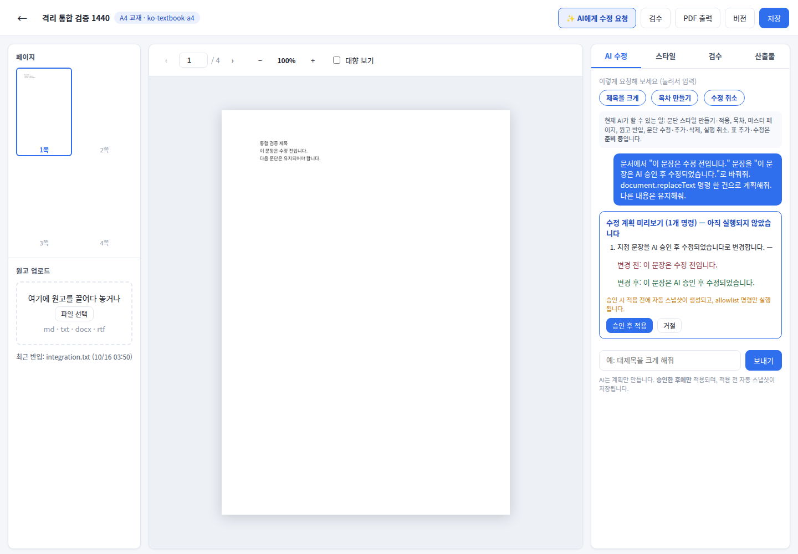
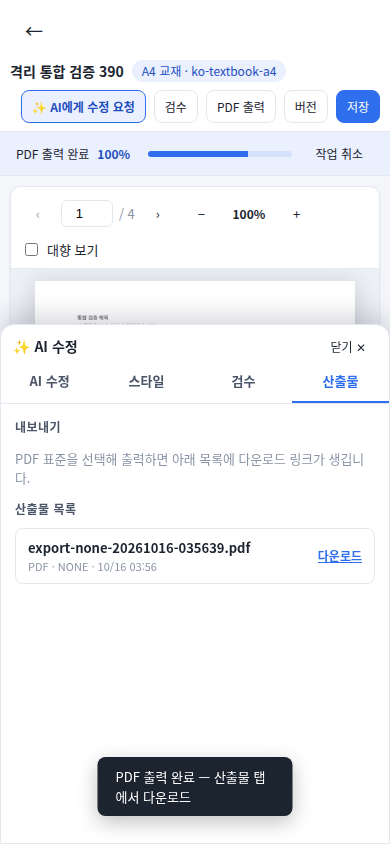

# DesignCraft #716 최종 통합 검증 (2026-10-16)

기존 회귀 테스트/CLI 품질 검증을 수동 재실행하지 않았다. 앱 코드와 독립된 `qa/designcraft-716-final` 브랜치에서 격리 MySQL 8.0·Spring·실제 Muse Spark·Chrome UI 통합 흐름만 실행했다. 운영은 기존 OIDC 역할/SSM 대상의 고정 읽기 전용 Python 조사만 실행했고, 추가 IAM/SSM 권한 변경은 없었다.

## 실제 통합 검증

검증 대상 기본 head: `0dc3d3e49def356147f4aaf5a4bdfcfff7a3b972`.
최종 애플리케이션 head: `f244717581c5dce7413858407ca80fb95d833f03` (모바일 패널 수정 1파일).

첫 실행: https://github.com/woori73/feel2real-buildit/actions/runs/38847325098
- 격리 MySQL 신규 DB에 운영 스키마 마이그레이션(운영 DB 아님), synthetic TUTOR 계정과 BCrypt 비밀번호를 생성.
- 브라우저 홈페이지 로그인 모달에서 아이디/비밀번호로 실제 인증 → HTTP-only JWT 쿠키 발급 → DesignCraft 편집기로 이동. 쿠키 직접 주입이나 인증 우회 없음. 운영 네이버 로그인 검증은 이 테스트에 포함하지 않는다.
- PC 1440×1000: 실제 TXT 첨부→업로드→CLI 조판/미리보기→Muse Spark 계획 생성→원문/수정안 표시→승인 전 정본 SHA 불변→승인 클릭→정본/문장 변경→검수→일반 PDF 생성/브라우저 다운로드/재열기→인증된 버전 API로 복구까지 진행.
- PC 다운로드 PDF를 로컬에서도 재열어 수정된 문장과 4페이지를 확인했다.
- 모바일 390×844도 실제 로그인·문서 반입·AI 패널 열기/닫기·실제 Muse 계획·승인 전 미변경·승인 후 변경까지 성공.
- 첫 실행 전체 verdict는 FAIL: 모바일 PDF 생성 후 산출물 패널이 닫혀 다운로드 링크를 누르지 못했다. PC 완료까지 포함된 실행을 전체 PASS라고 표기하지 않는다.
- 실제 Muse Spark HTTP 200: 2건. mock/stub/응답 대체 없음.
- 첫 하네스는 download promise timeout의 비동기 오류 때문에 최종 results.json 기록을 못 했다. 따라서 PC 증거는 실행된 순서의 화면 캡처·다운로드 PDF·스크립트의 사전 assertion과 서버 HTTP 성공 집계이며, PC API 목록/콘솔 수치는 보존되지 않았다. 없는 수치를 추정하지 않는다.

## 검증 중 새로 발견해 수정한 코드

`src/main/resources/static/js/publishing_editor.js` 하나:
- 공통 `openPanel(name)`를 재사용.
- 모바일에서 상단 검수를 누르면 검수 패널을 열고, PDF 생성 성공 후 산출물 패널을 열도록 수정.
- AI 버튼은 동일 helper로 AI 탭을 열고 입력창에 초점을 준다.

PC 완료 흐름은 다시 돌리지 않고, 모바일만 새 격리 환경에서 최종 미완료 흐름을 재검증했다. 하네스는 단계마다 results.json을 저장하고 다운로드 대기 오류를 본문 없이 처리하도록 수정했다. 이 하네스 수정은 제품 동작의 mock/우회가 아니다.

모바일 수정 후 실행: https://github.com/woori73/feel2real-buildit/actions/runs/38847828370
**SUCCESS**. 실제 로그인→TXT 반입/조판/미리보기→실제 Muse Spark 계획(승인 전 정본 불변)→승인→수정→PDF 다운로드/재열기→이전 버전 복구까지 PASS. 모바일 패널 열기/닫기도 PASS.

API: login 200, import 202, manuscript 200, AI plan 200, revisions 200, preflight 200, export 202, artifacts 200. 인증 전 auth/me 401은 예상 결과. 실제 Muse HTTP 200 1건, CLI 비정상 종료/서버 startup 실패 0건. `pageErrors=0`, **consoleErrors=6건은 원문을 수집하지 않아 원인 분류 미완료**다. 통합 흐름 성공을 콘솔 무오류로 확대하지 않는다. 오류 분류는 남은 검증이며 Draft 유지 사유다.

증거: `designcraft-final-evidence/mobile-results.json`, `mobile-server-metrics.json`, PC/모바일 PNG와 실제 다운로드 PDF. 화면은 synthetic 문서다.

프로비넌스: 모바일 실행 QA commit `0b71acc30bc5b1f044f3eb7f4a80291e81eec342`의 애플리케이션 src/build.gradle/settings.gradle/ops/designcraft는 최종 PR head와 git diff가 없다. 결과 JSON의 target은 하네스가 기록한 기본 head(0dc3d3e4)이며 모바일 수정 포함 여부는 이 tree 비교로 확인했다. PC는 모바일 수정 전 head에서 완료했다. 새 수정은 모바일 패널 표시 한 파일이므로 완료한 PC 흐름을 반복하지 않았다.

## API 키·원문 로그 보호

API 키는 기존 저장소 Secret에서 CI 환경변수로만 주입하고 값은 읽어 출력하지 않았다. 브라우저는 localhost로만 요청하고 Muse Spark는 Spring의 기존 Meta transport가 직접 호출한다. 테스트는 요청/응답 본문·쿠키·console 원문·raw 예외를 출력하지 않고 HTTP method/path/status만 저장한다. 앱 로그는 원본을 업로드하지 않으며 서버 집계는 허용된 카운터/예외 클래스만 추출한다. 키 값이나 원문을 예외 메시지로 재출력하지 않는다. 화면과 PDF에는 사용자 요청에 따라 공개 가능한 synthetic 검증 문장만 포함한다.

## 운영 장애 원인 — 확인 완료

기존 역할/SSM 고정 읽기 전용 실행:
- https://github.com/woori73/feel2real-buildit/actions/runs/38847499973
- 요구 심볼/바이너리 해시 추가 확인: https://github.com/woori73/feel2real-buildit/actions/runs/38847628715

증거: `designcraft-final-evidence/production-readonly.json`.

- 실제 서비스 사용자: ec2-user, 실행 중.
- 실제 설정/기본 CLI 경로: `/opt/designcraft/designcraft-cli`.
- 파일 존재·일반 파일·mode 0751·서비스 사용자 실행권한 모두 확인.
- 설치 파일 SHA-256 `64a467a06dceac46a7cca5990e46946faa1027d3b33228f1c42caaff9e33da87`: 저장소의 기존 CLI 0.6.0 실행파일과 정확히 일치.
- 해당 서비스 사용자로 `--version` 실행해도 종료코드 1. stderr의 요구 심볼은 `GLIBC_2.35`.
- 운영 glibc: 2.34. 따라서 설치된 바이너리의 런타임 요구와 불일치해 조판 프로세스 자체가 시작되지 못한다.
- 세 템플릿/정본/한글 폰트 모두 존재. 작업 저장소·/tmp는 서비스 사용자 쓰기 가능.
- 최근 12000 서비스 로그(10/14 UTC 이후)에서 DesignCraft glibc 오류 3건·CLI 비정상 종료 3건. 파일 없음/권한 거부/timeout/provision 실패 분류는 0건. 원문 로그는 노출하지 않았다.

확정 원인은 CLI 미설치나 템플릿 누락이 아니라 **glibc 2.35 요구 바이너리와 운영 glibc 2.34의 비호환**이다. 임의의 모든 과거 실패가 동일 원인이라고 확대하지 않으며, 조사 범위의 현재 실행 실패와 해당 오류 기록에 대한 결론이다.

## 운영 반영 전 별도 승인 사항

공식 0.8.0 Linux x86_64 바이너리도 GLIBC_2.35를 참조하므로 현재 설치 스크립트로 공식 파일만 교체하면 운영 문제는 해결되지 않는다.

1. glibc 2.34 이하 환경과 호환되는 0.8.0 CLI를 격리 빌드·검증한다. 운영의 실제 OS 정보로 동일 계열 빌드 기준을 먼저 확정한다. source/tag `11a51d5...` 고정 및 산출물 SHA·라이선스·의존성 목록 필요.
2. 호환 바이너리로 import/preview/AI 승인 수정/PDF 표준·한글 글꼴 검증, 실제 운영 OS 버전의 격리 환경 smoke를 통과해야 한다.
3. 구 CLI·환경파일·템플릿·프로젝트 백업, 버전별 새 경로 배치, 서비스 사용자 실행, CLI 경로 전환, 필요한 재시작·배포 및 기존 파일 처리에 대한 명시적 승인 후 운영 반영한다.
4. 시스템 glibc 교체·OS 업그레이드·새 유료 인프라는 이번 수정안에 포함하지 않는다.
5. 롤백은 기존 경로·JAR·템플릿·프로젝트 사본 복원이다. 단 기존 CLI 자체도 실행 불가이므로 롤백이 DesignCraft 정상화를 보장한다는 뜻은 아니다.

## HWPX — 별도 구현 범위·테스트 계획 (이번 구현 없음)

현재 별도 HWPX Worker는 기존 HWP/HWPX의 표 셀 편집·HWPX 저장만 담당한다. DesignCraft native 문서에서 HWPX를 생성하는 변환 경로/UI는 없다.

별도 범위:
- native 문서 모델에서 문단/문자 스타일, UTF-8 텍스트, 표·병합/크기/셀 여백, 이미지, 페이지·여백·머리말/꼬리말을 추출하고 중간 모델로 정의.
- HWPX 생성기로 모델을 매핑하고 지원하지 않는 DTP 배치·글흐름·마스터/상호참조/폰트 대체를 명시. 지원하지 않는 문서를 성공 처리하거나 PDF를 HWPX로 명명하지 않음.
- 소유자 검사·명시적 export 형식·artifact 등록·파일 확장자/Content-Type·다운로드 계약·원본 보존·취소/실패 정리를 별도 구현. 현재 export controller가 알 수 없는 format을 PDF로 처리하는 점도 명시적 미지원 응답으로 개선해야 함.
- 내용 보존과 시각적 동일성은 분리 판정. 한컴 렌더러와 DesignCraft의 레이아웃/폰트 엔진 차이로 동일 페이지 수·줄바꿈·좌표 보존을 자동 보장할 수 없음.

검증 계획:
- 한글·영문·이모지/유니코드, 빈/다단락·스타일·단락 삭제/추가, 단순·중첩·인접 병합 표, 표 안 여러 문단, 이미지, 다페이지/목차/마스터 fixtures.
- XML·ZIP/HWPX schema 무결성, 재열기 후 텍스트·표·행열·병합·이미지 개수/해시 확인.
- 한컴 프로그램에서 재열기·PDF 렌더 후 페이지/한글 글꼴/표/문단을 시각 비교.
- 실제 로그인→DesignCraft 수정→HWPX 내보내기→다운로드→한컴 재열기 PC/모바일 E2E, 잘못된 형식·미지원 기능·손상 입력·대문서·timeout·권한·원본 불변 검증.

## #715 포함·중복 병합 정리

#715 head `08347f5f...`는 #716 head의 실제 조상. GitHub compare의 merge-base도 동일하고 behind_by=0이다. #715의 패널 버튼·기본 AI 탭·모바일 시트·예시 칩·오류 배너·JS 계약 파일을 유지한다. 후속 차이는 변경 전후 표시·반입 지속 오류·기능 안내 갱신 및 이번 모바일 패널 수정이다.

권장: #716만 최종 검토/승인 대상에 두고 #715는 **#716 병합 후** '포함됨/대체됨'으로 닫는다. #715와 #716을 각각 독립 squash 병합하지 않는다. 이번에는 두 PR 모두 병합/종료하지 않았다.

## Draft 판정과 CI

최종 head `f244717581c5dce7413858407ca80fb95d833f03`:
- [Build Check #1693](https://github.com/woori73/feel2real-buildit/actions/runs/38847868856): build SUCCESS, mysql-integration-test SUCCESS.
- [DesignCraft QA #28](https://github.com/woori73/feel2real-buildit/actions/runs/38847868904): SUCCESS.
- 최신 main `69fe4bd356cf561a536ded77367f8f79bc6c7720` 재확인. GitHub mergeable=true, 충돌 없음.

**Draft 유지 권장**: 핵심 격리 E2E는 완료했으나 모바일 콘솔 6건 분류가 남았고 운영 호환 0.8.0 바이너리는 준비되지 않았다. HWPX 미구현은 별도 범위이며 기존 셀 수정과 무관하다. 운영 배포 준비 완료를 의미하는 Draft 해제는 아직 권하지 않는다. 이번에 새로 확인한 모바일 장애 외에 기존 기능 개발/회귀/CLI 테스트를 수동 반복하지 않았다. 새 코드 commit에 자동 실행되는 필수 CI만 확인한다. 실제 Draft 해제·main 병합·운영 배포는 하지 않았다.
