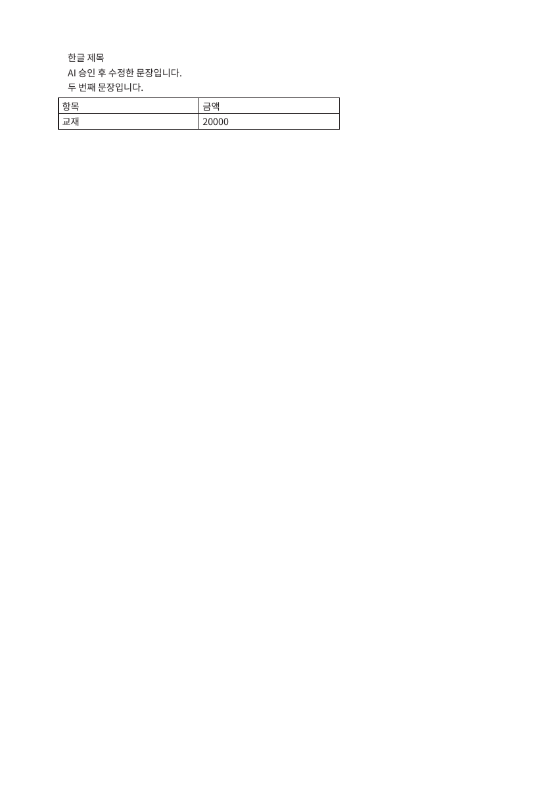

# DesignCraft #716 남은 장애 해결 검증

기존 로그인→문서 반입→AI 승인 편집→PDF 다운로드 흐름, 기존 회귀 테스트와 0.6/공식 0.8 CLI 테스트는 반복하지 않았다. 이번 실행은 콘솔 전용 탐색과 **새로 빌드하는 호환 바이너리 자체의 검증**이다. 운영은 OS·서비스 경로·자원 메타데이터의 읽기 전용 조사만 했다.

## 콘솔 6건의 원인과 영향

첫 콘솔 전용 실행: https://github.com/woori73/feel2real-buildit/actions/runs/38848999565

기존 하네스의 localhost-only 조건에서 PC 1440px, 모바일 390px 모두 아래 **정확히 6건**을 재현했다. 6건 모두 로그인 화면 단계이며 편집기 JavaScript pageerror는 0건이다. API 키·문서·쿠키·원문 console 메시지는 저장하지 않았다. 허용된 URL의 hostname/path, HTTP 상태, 표준 network 오류 코드만 보존한다.

| 건수 | 원인 | 기능 영향 | 조치 |
|---|---|---|---|
| 2 | Pretendard CSS / Google Fonts CSS를 테스트 하네스가 의도적으로 abort | 로그인 랜딩 폰트 fallback | 일반 네트워크 조건에서 별도 수집. DesignCraft CSS는 로컬 파일. 제품 수정 불필요 |
| 2 | GSAP / ScrollTrigger 스크립트를 동일 하네스가 abort | 랜딩 애니메이션 생략 | 편집기 조판·AI·다운로드와 무관. 제품 수정 불필요 |
| 1 | Google Tag Manager를 동일 하네스가 abort | 분석 이벤트 미수집 | 편집기 기능 영향 없음. 제품 수정 불필요 |
| 1 | 로그인 전 `/api/auth/me`가 HTTP 401 반환 | 정상 비로그인 판정 | 401을 200으로 숨기거나 인증 코드를 바꾸지 않음 |

첫 수집 실행은 모바일 빈 프로젝트 화면에서 불필요한 AI FAB 클릭을 기다려 하네스가 실패했다. 그 화면의 FAB는 기존 정책상 프로젝트를 연 뒤 나타나는 버튼이므로 제품 장애로 분류하지 않았다. 이미 완료한 패널 기능을 반복할 필요가 없어 클릭을 제거했고, 수집 완료한 차단 조건은 반복하지 않았다. 첫 실행의 콘솔 JSON은 그대로 보존한다.

일반 네트워크 수집: https://github.com/woori73/feel2real-buildit/actions/runs/38849356743 — **SUCCESS**. PC 1440px / 모바일 390px 각각 로그인 전 예상 401 1건만 남음. 인증 후 편집기 console error 0건, pageerror 0건. 외부 자원 5건 실패는 사라졌다. auth/me의 ERR_ABORTED 요청 레코드도 로그인 단계의 동일 요청으로 기록됐으며, 추가 console/pageerror는 없었다. 페이지 전환 시 응답 수신 취소로 해석하되 별도 제품 오류로 집계하지 않았다.

제품 코드 수정은 **없음**. 콘솔 증거는 `console-local-only.json`, `console-normal-network.json`, PC·모바일 진입 화면도 진단 자료로 보존한다. 단 콘솔 전용 runner에서 시스템 CJK 폰트 설치를 생략한 캡처는 UI 품질 판정에 사용하지 않는다. 하네스의 폰트 설치는 복구했고, 기존 폰트 설치 E2E의 정상 화면 검증을 반복하지 않았다. 빈 프로젝트 진입까지만 수행했고 원고 업로드·AI·수정·PDF 사용자 흐름은 재실행하지 않았다.

## glibc 2.34 호환 바이너리

격리 빌드 실행: https://github.com/woori73/feel2real-buildit/actions/runs/38848999619

- upstream DesignCraft 0.8.0 source commit `11a51d5b665aec8d6e675bd107a8a01514f10d00`, upstream 원본 Cargo.lock, Rust 1.95.0 고정.
- Amazon Linux 2023 컨테이너에서 `cargo build --release --locked -p designcraft-cli`, LTO=false / opt-level=2 / jobs=2. 운영에서 빌드하지 않음. 빌드 이미지 OS는 Amazon Linux 2023.12.20261014이며 운영 2023.11과 point release는 다르다. 두 환경의 glibc ABI는 2.34로 동일하다.
- 컨테이너 digest·rustc/Cargo 버전·lock SHA·ELF 요구 심볼·실제 ldd 의존성을 기록. 재실행 시 기록된 digest를 사용해야 하며 `:2023`의 미래 내용을 동일 이미지로 간주하지 않음.
- 컴파일러 없는 새 컨테이너에서 glibc 2.34를 확인하고 `--version`, `ldd`, 세 한글 템플릿의 TXT 반입/조판/native PNG/PDF, 기존 0.6 생성 native(DOCX 표 포함) 재열기·PDF 검증. 이 검증은 기존 공식 바이너리 테스트의 반복이 아니라 새 산출물의 ABI·문서 호환성 검증이다.
- PDF를 pdftotext/pdffonts로 재열어 한글 본문·표 텍스트·NotoSansKR 포함 확인하고 PDF-rendered PNG도 생성한다. 화면 검토 후 결과 기입.

빌드 및 glibc 2.34 런타임 smoke는 성공했다. 첫 실행 전체 verdict는 FAIL: 호스트 PDF 증거 저장 단계에서 컨테이너 root 소유 파일에 대한 PermissionError가 발생했다. 제품/바이너리 실패가 아니다. 빌드 artifact를 그대로 받아 남은 PDF 검증/패키징만 별도 실행하며 재컴파일/기존 ABI smoke는 반복하지 않는다. 재현 워크플로는 root 소유 출력 처리도 수정했다.

- binary SHA-256: `2edd60ef2f575263a31ad6cb1ec661181bd24207d4aefbec8516b04990700335`.
- ELF 최대 요구 GLIBC **2.34**. GLIBC_2.35 이상 요구 없음.
- 동적 실행 의존성: `/lib64/ld-linux-x86-64.so.2`, `libc.so.6`, `libm.so.6`, `libgcc_s.so.1`. ldd missing 0. Rust·컴파일러·Python·X11·브라우저는 CLI 실행 의존성이 아니다(Python은 검증 도구에만 사용).
- 세 템플릿 ko-book-46 / ko-textbook-a4 / ko-workbook-b5에서 새 바이너리 TXT 반입·inspect·PNG·PDF 성공, 기존 0.6 native 열기·PDF 성공.
- 0.6 fixture SHA `0fb0e7e3f00d993399fe80c4d786750b038ce8edcaa2323b96f8dfd751df979c`; 공개 synthetic 문서이며 원래 사용자 파일이 아니다.
- NotoSansKR-Regular SHA `57c923e0f2645ff3c5d4945e30562dc068282198a5184b064f692b40c6fbeea0`, Bold `e66121ce0579ec53f3eecec557b496b2bc0b62802d3641fe0471a0c54302422e`.
- 빌드 이미지 `public.ecr.aws/amazonlinux/amazonlinux@sha256:18c71e6a20f8b0834b002b6002156a84eea76162d5adea72d2ea8b86800eaf91`.

PDF 검증/패키징 실행 https://github.com/woori73/feel2real-buildit/actions/runs/38849898242 — SUCCESS.기존 PDF 네 개의 한글 본문·NotoSansKR·기존 표 내용 확인 PASS. 직접 본 PDF 렌더에서 한글 문장·표 테두리/행/열을 확인했다. 단순 문서의 대표 fixture 판정이며 모든 운영 문서/대문서 fidelity를 보장하지 않는다.

최종 자원 계측/패키징 https://github.com/woori73/feel2real-buildit/actions/runs/38850191210 — **SUCCESS**. 원래 shell의 dnf child 사용량이 섞일 수 있는 누적 ru_maxrss 대신 os.wait4로 CLI별 최대 RSS만 측정했다. 중간 재개 실행(38850096529)은 artifact의 기존 PDF 출력 소유권 때문에 실패했고, 출력 초기화 후 완료했다. 완료한 빌드·ABI smoke·PDF 검증은 다시 실행하지 않았다.

- 비특권 UID/GID 65534, glibc 2.34에서 --version 및 소형 기존 native→PDF 성공.
- binary **44,959,664 bytes (42.88 MiB)**. 소형 fixture에서 CLI peak RSS **49,168 KiB (48.02 MiB)**, version+PDF elapsed 0.072초. 이 값은 격리 컨테이너 측정이며 운영 지연·대문서·동시 작업의 상한이 아니다.
- 배포 archive **18,950,047 bytes**, SHA-256 `5d4a3e7b9a0569ed904ae41d777c1a02854e579fd8aaa2769a34a4c3228aee6d`.
- [최종 바이너리·라이선스·manifest·PDF artifact](https://github.com/woori73/feel2real-buildit/actions/runs/38850191210/artifacts/12024728328). Actions artifact ZIP 자체의 SHA는 `2d189061a9a92ce00eb3d283765dacc581bd860dd817b3b1e3587564c924951b`로, 내부 배포 tar.gz SHA와 구분한다. 보존 기한 2026-11-15 UTC.

## 운영 조사 및 적용 범위

https://github.com/woori73/feel2real-buildit/actions/runs/38848999544 — 기존 역할의 고정 SSM read-only 실행 SUCCESS. OS는 Amazon Linux 2023.11.20260514 x86_64, glibc 2.34. 환경 값/DB/문서/로그를 읽지 않았다. 메타데이터 증거는 `designcraft-final-evidence/production-os-readonly.json`.

기존 glibc 장애 원인은 이전 보고서 그대로이며, 시스템 glibc를 업그레이드하지 않는다. 엔진 안정 경로는 매 CLI 프로세스 생성 시 참조하므로 원자적 경로 전환만으로 엔진 교체 가능. 앱 PR 배포의 서비스 재시작과 분리한다.

구체적인 설치/백업/롤백/서비스 재시작/예상 중단 및 별도 승인 범위는 [운영 적용 승인 요청서](DESIGNCRAFT_716_OPERATIONS_APPROVAL.md).

## PR / Draft

검증 대상 PR head `f244717581c5dce7413858407ca80fb95d833f03`.
**검토용 Draft 해제 가능**으로 판정한다. 이번 두 미검증 항목(콘솔 원인·호환 바이너리)이 해결됐으며 제품 코드 추가 수정은 없다. 실제 Draft 해제는 하지 않고 판단만 보고한다.

동일 head의 Build Check #1693(run 38847868856) build/mysql-integration-test SUCCESS, DesignCraft QA #28(run 38847868904) SUCCESS를 재확인했고 수동 재실행하지 않았다.

마지막 확인 main은 #717이 추가된 `abc7bebcdb2b167cca0fc9666c75cd6993e27301`. 기존 main `69fe4bd3`의 직계 후속이며 public/landing.html·landing_home.css·홈 계약 테스트/문서만 변경됐다. DesignCraft·로그인 fragment·SecurityConfig·CI·Flyway 변경 없음. `git merge-tree --write-tree --merge-base=69fe4bd3 main head` exit 0, 합성 tree `20206ba95544b743c7e8891362c9495e280c1c04`: 충돌 없음. 실제 병합/branch 업데이트/합성 tree CI는 실행하지 않았다. 이번 콘솔 수집은 PR head의 기존 랜딩 기준이며 #717 합성 랜딩을 다시 브라우저 검증한 것은 아니다. 실제 Draft 해제·main 병합·#715 종료·운영 설치·재시작·배포·AWS 설정·운영 DB 변경은 하지 않았다.

#715는 #716의 실제 조상으로 포함돼 있다. #716 병합 및 main CI 성공 후 #715를 포함됨으로 종료하도록 제안한다. DesignCraft→HWPX 내보내기는 계속 미구현이며 기존 셀 수정과 별개다.
