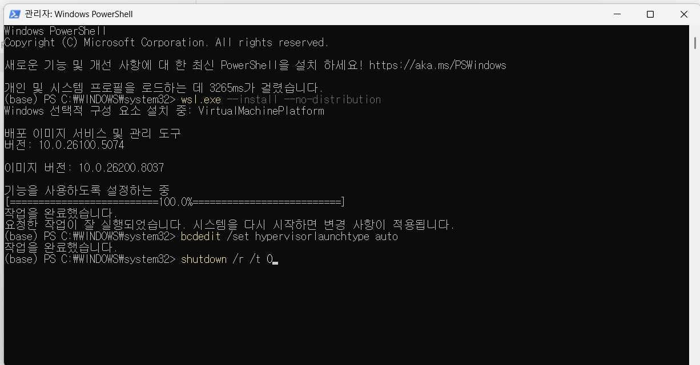
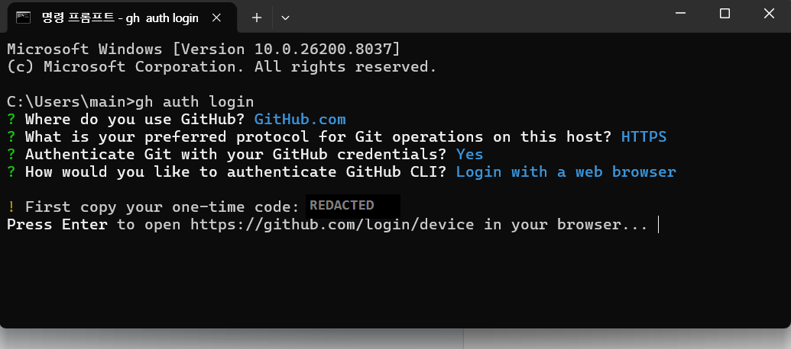

# Windows 로컬 개발 환경 준비 (Windows Local Setup)

> Windows 11에서 이 저장소를 **처음** 세팅할 때만 필요한 문서다. macOS/Linux는 건너뛴다.
> 세팅이 끝난 뒤의 실행·PR·배포 절차는 [WORKFLOW.md](WORKFLOW.md)가 단일 출처다.

`./scripts/run-local.sh` 한 번으로 앱이 뜨는 게 목표지만, 그 전에 아래 4가지가 준비돼 있어야 한다.

| 항목 | 용도 | 없으면 |
|---|---|---|
| WSL2 | Docker Desktop이 쓰는 리눅스 VM | Docker 엔진이 시작하다 죽는다 |
| Docker Desktop | 로컬 MySQL(`localhost:3308/f2r_db`) | `run-local.sh`가 1단계에서 중단 |
| JDK 21 | `build.gradle`의 toolchain 21 | `./gradlew`가 아예 실행 안 됨 |
| Git Bash | `run-local.sh`가 bash 스크립트 | PowerShell에서 실행 불가 |
| GitHub CLI (`gh`) | 이슈·PR 생성 (§5) | 앱 실행에는 불필요 |

---

## 1. WSL2

**관리자 PowerShell**에서 실행한다. 일반 권한으로 실행하면 선택적 구성 요소가 켜지지 않은 채 끝날 수 있다.

```bash
wsl.exe --install --no-distribution
```

- Ubuntu 같은 배포판은 **설치할 필요 없다.** Docker Desktop이 `docker-desktop` 배포판을 스스로 만든다.
- `--no-distribution`을 빼면 배포판 설치까지 시도하다 중간에 끊길 수 있다.

이어서 하이퍼바이저가 부팅 시 로드되도록 한다. 구성 요소만 켜고 이 값이 `off`면 하이퍼바이저는 끝내 안 뜬다.

```bash
bcdedit /set hypervisorlaunchtype auto
```

마지막으로 **재시작**한다.

```bash
shutdown /r /t 0
```

세 명령을 연달아 실행한 모습이다. `wsl.exe --install --no-distribution`이 `VirtualMachinePlatform`을 켜고, `bcdedit`이 `작업을 완료했습니다`를 출력하면 준비가 끝난 것이다. **"시스템을 다시 시작하면 변경 사항이 적용됩니다"** 문구가 핵심이다 — 이 시점까지는 아직 아무것도 동작하지 않는다.



> ⚠ **"시스템 종료 → 전원 켜기"로는 적용되지 않는다.** 빠른 시작(Fast Startup)이 켜져 있으면 커널 세션을 최대 절전 파일에서 복원하기 때문에 하이퍼바이저 관련 변경이 반영되지 않는다. 반드시 **다시 시작(Restart)** 을 쓴다.

### 검증

```bash
powershell -Command "(Get-ComputerInfo -Property HyperVisorPresent).HyperVisorPresent"
```

`True`여야 한다. `False`면 아직 하이퍼바이저가 안 떴다는 뜻이고, Docker는 절대 안 뜬다.

### `False`일 때 진단 순서

```bash
powershell -Command "Get-CimInstance Win32_OptionalFeature -Filter \"Name='VirtualMachinePlatform'\" | Select-Object Name,InstallState"
```

- `InstallState=2`(Disabled) → 1단계가 실패한 것. 관리자 권한으로 다시 실행.
- `InstallState=1`(Enabled)인데 `HyperVisorPresent=False` → **재부팅이 반영되지 않은 것.** 빠른 시작을 의심하고 "다시 시작"으로 재부팅.
- 하드웨어/BIOS 확인이 필요하면:

```bash
powershell -Command "Get-ComputerInfo -Property HyperVRequirementVirtualizationFirmwareEnabled,HyperVRequirementSecondLevelAddressTranslation"
```

둘 다 `True`면 BIOS는 손댈 필요 없다.

---

## 2. Docker Desktop

설치 후 **수동으로 실행**한다(자동 시작이 꺼져 있을 수 있다). 고래 아이콘이 "Engine running"이 될 때까지 기다린다. 첫 기동은 `docker-desktop` 배포판을 만드느라 1~2분 걸린다.

```bash
docker info
```

`ServerVersion`이 나오면 준비된 것이다.

### 엔진이 안 뜰 때

프로세스는 살아있는데 엔진만 안 붙는 경우, 원인은 로그에 직접 찍힌다.

```bash
tail -40 ~/AppData/Local/Docker/log/host/com.docker.backend.exe.log
```

- `vsock:4099 ... A socket operation encountered a dead network` → 붙을 리눅스 VM이 없다는 뜻. **1단계(WSL2)로 돌아간다.**
- `cannot toggle VM OTel collector, backend is not running` → 같은 원인. VM 안의 backend가 못 떴다.

---

## 3. JDK 21

**관리자 PowerShell**에서 실행한다.

```bash
winget install --id Microsoft.OpenJDK.21 -e --accept-package-agreements --accept-source-agreements
```

설치 시 `JAVA_HOME`과 `Path`가 시스템 환경변수에 자동 등록된다. 다만 **이미 열려 있던 터미널은 갱신된 환경변수를 받지 못한다.** 새 터미널을 열어서 확인한다.

```bash
java -version
```

`21.x`가 나와야 한다. Gradle의 toolchain 자동 다운로드는 Gradle을 돌릴 JVM이 먼저 있어야 동작하므로, JDK가 없으면 대안이 되지 못한다.

---

## 4. 실행

**Git Bash에서** 실행한다. PowerShell에서는 동작하지 않는다.

```bash
./scripts/run-local.sh
```

이 스크립트가 MySQL 컨테이너 생성 → healthy 대기 → `local` profile 고정 → `bootRun`까지 한다. `ANTHROPIC_API_KEY`는 없어도 부팅된다(`anthropic.enabled: false`가 기본). 첫 실행은 MySQL 이미지·Gradle 배포판·의존성을 받느라 수 분 걸린다.

DB만 초기화하려면 [WORKFLOW.md](WORKFLOW.md) §1을 따른다.

---

## 5. GitHub CLI (`gh`) 설치와 권한 등록

앱 실행에는 필요 없다. [CONTRIBUTING.md](CONTRIBUTING.md) 형식으로 **이슈·PR을 만들 때** 필요하다.

```bash
winget install --id GitHub.cli -e --scope user --accept-package-agreements --accept-source-agreements
```

`--scope user`면 관리자 권한 없이 설치된다. 설치 후 PATH가 갱신되므로 **새 터미널을 열어야** `gh`를 인식한다.

### 권한 등록

```bash
gh auth login
```

대화형 절차다. 아래 순서로 답한다.

| 질문 | 선택 |
|---|---|
| Where do you use GitHub? | `GitHub.com` |
| Preferred protocol for Git operations | `HTTPS` |
| Authenticate Git with your GitHub credentials? | `Yes` |
| How would you like to authenticate GitHub CLI? | `Login with a web browser` |

일회용 코드가 나오면 복사하고 Enter를 눌러 브라우저를 연다. `github.com/login/device`에 코드를 입력하고 권한을 승인하면 끝난다.



> 위 화면의 일회용 코드는 문서화를 위해 가렸다. 이 코드는 수 분 내 만료되는 1회용이지만, 스크린샷·로그를 공유할 때는 습관적으로 가리는 편이 안전하다.

확인:

```bash
gh auth status
```

`Logged in to github.com` 이 나오면 `gh issue create` / `gh pr create`를 쓸 수 있다.

> `git push`는 Git Credential Manager가 따로 처리하므로 `gh` 인증 없이도 동작한다. 반대로 `gh` 인증이 됐다고 `git push`가 자동으로 되는 것도 아니다. 둘은 별개다.

---

## 6. Windows에서만 겪는 것들

### 6.1 앱이 떠 있으면 `./gradlew test`가 실패한다

```
Execution failed for task ':processResources'.
> Failed to clean up stale outputs
```

실행 중인 앱 JVM이 `build/`를 잠그고 있어서 그렇다. Windows는 열린 파일을 지우지 못한다. **앱을 먼저 중지하고** 테스트를 돌린다. 스크립트를 멈춰도 JVM이 남아있을 수 있으므로 확인한다.

```bash
powershell -Command "Get-Process java -ErrorAction SilentlyContinue | Select-Object Id,StartTime"
```

### 6.2 POSIX 파일 권한

```
java.lang.UnsupportedOperationException: 'posix:permissions' not supported as initial attribute
```

유닉스 권한(`rwx------`)을 파일/디렉터리 **생성 속성**으로 넘기는 코드는 NTFS에서 이 예외로 죽는다. Linux에서는 예외 자체가 안 나므로 **운영과 CI에서는 절대 드러나지 않는다.**

- 부팅을 막던 `LocalAcademyVideoUploadStorage.createPrivateDirectoryAtomically`는 해결됐다.
- **남아 있는 곳**: `LocalAcademyVideoUploadStorage.privateOutputStream`, `DefaultAcademyVideoRawValidator`의 `Files.createFile(raw, ...)`. 부팅에는 영향이 없고 **실제로 영상을 업로드할 때** 터진다.
- `Files.getPosixFilePermissions` / `setPosixFilePermissions`를 쓰는 테스트 3개(`LocalAcademyVideoUploadStorageTest`, `DefaultAcademyVideoRawValidatorSecurityTest`)는 Windows에서 실패한다. Linux CI에서는 통과한다.

> 파일/디렉터리 생성 시 POSIX 권한을 거는 코드를 새로 쓰거나 리뷰할 때는 `try/catch (UnsupportedOperationException)` fallback을 반드시 같이 넣는다. 저장소 안의 기존 예시를 그대로 따르면 된다.
