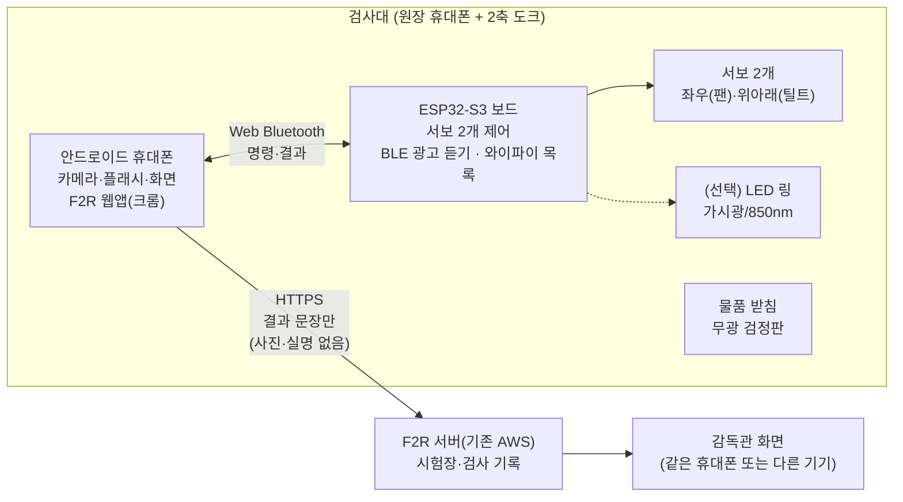
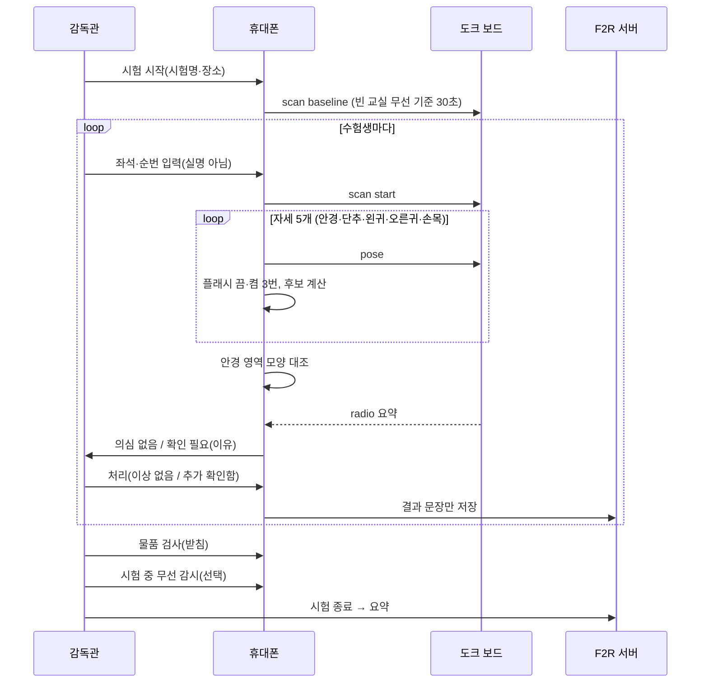
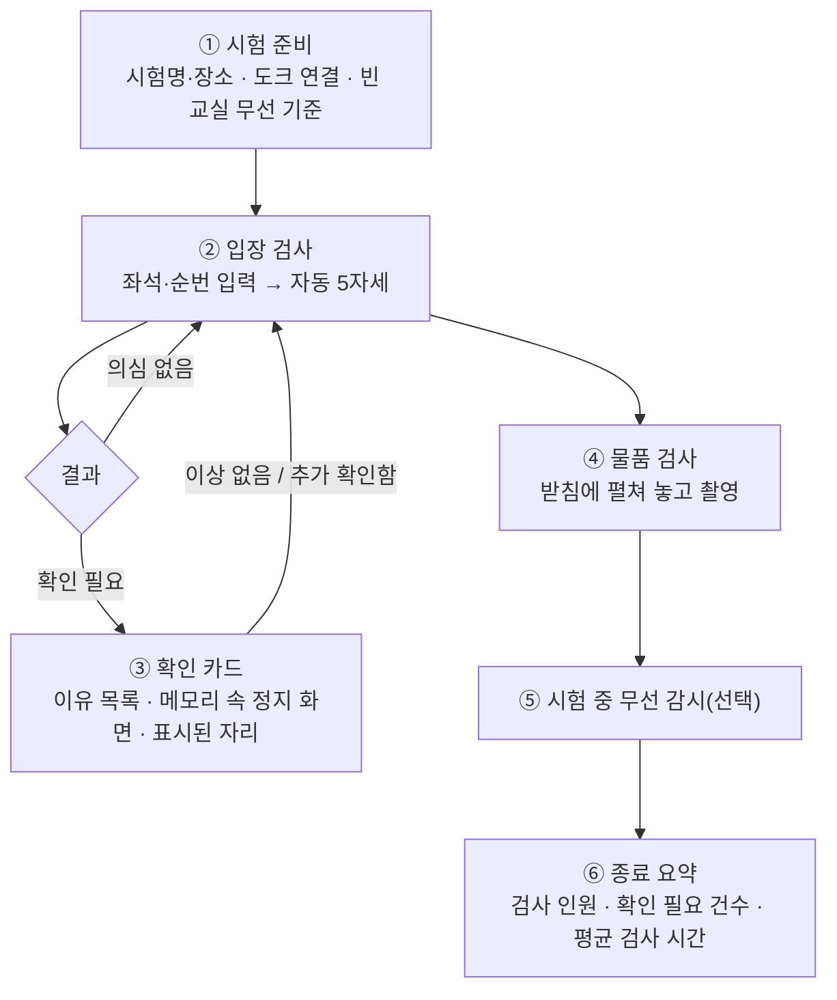

# F2R 시험 보안 검사대 — 설계서 (v0.1, 2026-11-20)

> 근거: [BRIEF.md](BRIEF.md) · 부품: [BOM.md](BOM.md) · 시험: [TEST_PLAN.md](TEST_PLAN.md) · 한계: [LIMITS.md](LIMITS.md)
> 범위: 설계와 시제품 계획까지만이다. 부품 구매, 운영 배포, AWS 자원 추가, 사람 촬영 시험은 하지 않았다([README.md](README.md) "결정 필요").

## 0. 한 줄 요약

원장 휴대폰을 2축 도크에 올려 **① 플래시 깜빡임으로 렌즈 반사를 찾고, ② 화면 속 안경 모양을 대조하고, ③ 도크 보드가 블루투스·와이파이를 검색**한다. 세 신호를 묶어 감독관 화면에는 **'의심 없음 / 확인 필요'만** 띄운다. 판정과 처리는 감독관이 한다.

## 1. 설계 전에 확인한 사실과 결정

| 확인한 것 | 설계에 준 영향 |
|---|---|
| **휴대폰 웹(브라우저)에서는 블루투스 광고 신호를 듣지 못한다.** 크롬의 Web Bluetooth는 정해 둔 기기 하나에 연결하는 기능만 기본으로 열려 있고, 주변 광고를 듣는 기능(`requestLEScan`)은 실험 설정을 켜야 한다. **와이파이 목록을 읽는 웹 기능은 없다.** | 블루투스·와이파이 검색은 **도크의 제어 보드(ESP32)**가 맡는다. 휴대폰은 Web Bluetooth로 도크에 연결해 결과만 받는다. 휴대폰 1대 + 보드 1장으로 서보 제어와 무선 검색을 같이 한다. |
| **플래시 켜고 끄기(torch)는 안드로이드 크롬에서 되고, 아이폰 사파리는 웹에서 플래시를 조절할 수 없다.** 아이폰 사파리는 Web Bluetooth도 없다. | 1차 시제품은 **안드로이드 휴대폰 + 크롬** 기준이다. 지시서의 "특정 모델에 묶지 않음"은 안드로이드 안에서는 지키고, 아이폰은 앱을 따로 만들 때 지원한다([결정 D2](README.md#결정-필요)). 1주차 시험에서 원장 휴대폰으로 다시 확인한다. |
| banrays 공개 실험: 메타 레이밴의 블루투스 신호는 **페어링할 때와 전원을 켤 때 주로 잡히고, 쓰는 중에는 꾸준히 잡히지 않았다.** 적외선(850·940nm) 반사도 약하고 들쭉날쭉했다(약 10㎝ 거리). | 무선 검색은 **보조 신호**로만 쓴다. 입장할 때 "안경을 벗었다 다시 쓰기"를 받으면 전원·연결 신호가 나올 가능성이 커지지만, 이것도 1주차에 확인할 가정이다. |
| banrays가 대조한 블루투스 식별값: 회사 ID `0x01AB`·`0x058E`(Meta), `0x0D53`(Luxottica), 서비스 UUID `0xFD5F`·`0xFEB7`·`0xFEB8`(Meta). 휴대폰 MAC 주소는 무작위로 바뀌어 쓸모가 없다고 적었다. | 처음 목록은 이 값으로 시작하고, 다른 제품(구글·샤오미·국내 제품 등)은 공개 자료로 확인해 하나씩 더한다([LIMITS.md](LIMITS.md) L4). |
| 저장소에 **'1.5단계 2축 도크' 설계 문서가 없다**(feel2real-buildit·academycraft 검색 결과 0건). | 도크는 서보 2개 + ESP32 보드 + 휴대폰 집게의 **일반 구성으로 적었다.** 1.5단계 실제 부품이 정해져 있으면 부품표만 바꾸면 되게 연결 방식(Web Bluetooth 명령)을 분리했다([결정 D1](README.md#결정-필요)). |
| 사람 눈동자도 플래시를 되쏜다(빨간 눈 현상). 렌즈 반사와 원리가 같다. | 얼굴을 비출 때는 **눈동자 자리를 후보에서 뺀다**(4-2). 물품 검사에는 해당 없다. |
| 사이트의 Claude 연결은 데모 단계라 꺼져 있다(`anthropic.enabled: false`). 외부 영상 AI는 유료 크레딧이 든다. | 안경 모양 대조는 **휴대폰 안에서 도는 모델**을 기본으로 한다. 외부 AI 사용은 크레딧 승인 뒤의 선택이다([결정 D4](README.md#결정-필요)). |

## 2. 구성도

| 부분 | 맡는 일 | 1차 시제품 방식 |
|---|---|---|
| 휴대폰 | 촬영, 플래시 깜빡임, 렌즈 반사 계산, 안경 모양 대조, 감독관 화면, 서버 전송 | 원장 휴대폰(안드로이드) + 크롬. 앱 설치 없이 F2R 웹앱 화면 |
| ESP32-S3 보드 | 서보 2개 각도 제어, BLE 광고 듣기, 2.4GHz 와이파이 목록, 휴대폰과 Web Bluetooth 연결 | 시중 개발 보드 1장. 펌웨어는 Arduino(ESP32 코어) |
| 서보 2개 | 휴대폰을 안경→단추→귀→손목 순서로 돌림 | 금속 기어 마이크로 서보(MG90S급) + 팬·틸트 받침 |
| LED 링(선택) | 휴대폰 플래시로 부족할 때만 추가 | 1주차 결과를 보고 넣을지 정한다 |
| 물품 받침 | 필기구·시계·안경·계산기를 올려 놓고 비춤 | 빛을 덜 튕기는 무광 검정판 + 30㎝ 높이 고정 |
| F2R 서버 | 시험장별 검사 기록, 감독관 확인 기록 | 기존 Spring Boot·MySQL·로그인·사업체 권한 재사용(5장) |

### 도크 연결 규칙 (보드 ↔ 휴대폰)

보드는 BLE 주변기기(GATT 서버) 하나로 보인다. 1.5단계 보드가 다르면 아래 명령만 맞추면 된다.

| 특성(characteristic) | 방향 | 내용 |
|---|---|---|
| `pose` | 휴대폰 → 보드 | `{"pan":-20,"tilt":10}` 각도(도). 도착하면 `pose_done` 알림 |
| `light` | 휴대폰 → 보드 | LED 링 켜기·끄기(선택 모듈 있을 때만) |
| `scan` | 휴대폰 → 보드 | `start` / `stop` / `baseline` |
| `radio` | 보드 → 휴대폰(알림) | 1초마다 요약: `{"ble":[{"vendor":"Meta","rssi":-58}],"wifiNew":1,"wifiTotal":14}` |

- 보드는 MAC 주소·SSID 원문을 휴대폰으로 보내지 않는다. 보드 안에서 그날만 쓰는 비밀값으로 해시해 "새로 나타났는지"만 센다(6장).
- 서보 전원은 보드 USB와 분리한다(서보가 움직일 때 전압이 떨어져 보드가 재시작하는 것을 막음).

## 3. 검사 흐름

### 3-1. 입장 검사 (목표 10초, 1차 완료 기준 30초)

| 순서 | 도크 자세(정면 60㎝ 기준 예시) | 찾는 것 | 예상 시간 |
|---|---|---|---|
| 1 | 얼굴 높이 | 안경 렌즈 반사(눈동자 자리 제외), 안경 모양 | 2초 |
| 2 | 가슴 | 단추·주머니 펜의 렌즈 반사 | 2초 |
| 3 | 왼쪽 귀(고개를 오른쪽으로 돌림) | 귀걸이형·이어폰형 카메라(렌즈 반사) + **이어폰 귀 확인**(감독관이 화면과 귀를 직접 봄) | 2초 |
| 4 | 오른쪽 귀(고개를 왼쪽으로 돌림) | 같음 | 2초 |
| 5 | 손목(손을 앞으로) | 시계·밴드 렌즈(스마트워치 측면 카메라 포함, [LIMITS.md](LIMITS.md) L19) | 2초 |
| 동시에 | — | 보드가 BLE·와이파이를 계속 들음 | 전체 시간 |

- 자세마다 플래시를 **끔→켬을 3번** 바꿔 찍고, **같은 자리에서 2번 이상** 빛난 점만 후보로 남긴다(시연 코드의 `consistentCandidates`). 한 번만 번쩍인 점(움직임·우연한 반사)을 걸러 잘못 알리는 비율을 낮춘다.
- 각도는 처음엔 고정값으로 시작하고, 2단계에서 얼굴 위치(얼굴 랜드마크)를 보고 도크가 따라가게 한다.
- 수험생 안내 문구(예): "안경을 벗었다가 다시 써 주세요. 고개를 양옆으로 돌려 귀를 보여 주세요. 정면을 보고 손을 앞으로 내밀어 주세요."
- **귀 확인(F2R 자체 기능, 미검증):** 3·4번 자세에서 휴대폰이 얼굴 랜드마크로 귀 자리를 잘라 크게 보여 준다. 플래시 끔·켬 3번 비교(4장과 같은 계산)로 **귓구멍 자리에 피부와 다르게 빛나는 면**(이어폰의 플라스틱·금속 겉면)이 같은 자리에서 2번 이상 나오면 원을 그린다. 1차는 무선 이어폰 **대조 카드**(모양·색)를 옆에 띄우고 감독관이 대조하고, 2차는 시험 세트로 학습한 작은 분류 모델을 휴대폰 안에서 돌린다(5장 안경 모양 대조와 같은 방식). 사진은 저장·전송하지 않는다.
- 귀 확인도 판정하지 않는다. 원이 그려지거나 감독관이 이어폰을 보면 '추가 확인함'으로 처리한다. 귓구멍 깊이 들어간 초소형 이어폰은 화면에도 안 보일 수 있다([LIMITS.md](LIMITS.md) L23).
- 보청기 사용 수험생은 시험 전에 신고받아 명단에 표시하고, 귀 확인에서 제출을 요구하지 않는다([LIMITS.md](LIMITS.md) F5).

### 3-2. 물품 검사 (목표 5초/묶음)

필기구·계산기·시계·안경을 받침에 펼쳐 놓고, 도크를 받침 쪽으로 내려 같은 방식(끔·켬 3번)으로 찍는다. 받침은 무광 검정이라 바탕 반사가 적고, 30㎝로 거리가 고정돼 기준값을 맞추기 쉽다.

### 3-3. 무선 검색

| 대상 | 방법(보드) | 화면 표시 |
|---|---|---|
| 알려진 스마트안경 BLE 신호 | 광고의 회사 ID·서비스 UUID를 목록과 대조(1장 표) | "스마트안경 제조사 신호(Meta) 가까이 있음" + 신호 세기 |
| 새로 나타난 와이파이 | 빈 교실 기준과 비교해 새 AP 수 | "기준에 없던 와이파이 n개" (휴대폰 핫스팟·LTE 라우터 후보) |
| 알려진 무선 이어폰 BLE 신호 | 스마트안경과 같은 방식으로 제조사 식별값 대조. **회사 ID만으로는 같은 회사 휴대폰과 구별되지 않으므로, 이어폰 기기 유형까지 공개 자료로 확인된 값만 목록에 넣는다**(1차 목록은 아직 확정하지 않음) | "무선 이어폰 신호 가까이 있음" + 신호 세기 |
| 블루투스 기기 수 변화 | 검사 전후 기기 수 | 참고값으로만 기록 |

- 와이파이는 **AP가 스스로 알리는 이름표(비콘)만** 읽는다. 기기가 보내는 연결 요청(probe request)을 엿듣는 기능은 기본으로 끈다(법률 검토 전, [LIMITS.md](LIMITS.md) L9).
- **신호를 막거나 끊는 기능(재머·연결 끊기)은 보드 펌웨어에 넣지 않는다.** 듣기만 한다.
- ESP32-S3는 최신 방식 블루투스(BLE)만 듣는다. 일부 이어폰이 쓰는 기존 방식 블루투스(Classic)는 못 들어서, 이어폰을 대상에 넣으면 ESP32 기본형(ESP32-WROOM-32 계열, BLE+Classic)로 바꾸거나 함께 쓰는 안을 검토한다([결정 D11](README.md#결정-필요), [LIMITS.md](LIMITS.md) L22). 기존 방식도 연결되기 전에만 흔적이 잘 보인다.

### 3-4. 시험 중 (선택)

**돌아가며 한 번 더 검사(순회):** 입구 검사 뒤, 시험 중에 감독관이 휴대폰을 들고 줄마다 돌며 1~2m 거리에서 [렌즈 찾기]를 한 번 더 누른다(시연 화면 '가까이'). 교실 앞에서 여러 명을 한 번에 볼 때는 '멀리'(3~5m, 카메라가 되면 3배까지 확대, 기준값을 낮춤)를 고른다. 두 거리 모두 **아직 재지 않은 시작값**이며, '멀리'는 잘못 알리는 경우가 늘 수 있다.

휴대폰과 도크를 교실 앞에 두고 1분마다 무선 요약을 기록한다. 기준보다 와이파이·스마트안경 신호가 늘면 감독관 화면에 "확인 필요(교실 앞 무선 변화)"를 띄운다. **행동 분석(시선·자세)은 이번 설계에서 '검토'로만 둔다**(정상 행동 오인 위험, [LIMITS.md](LIMITS.md) L10).

### 3-5. 결과 묶기 (판정하지 않음)

| 신호 | '확인 필요'로 올리는 조건(초기값, 1주차에 조정) |
|---|---|
| 렌즈 반사 | 같은 자리 2회 이상 반사 점 1곳 이상 |
| 안경 모양 | 안경 테 옆에 작은 원형 구멍·두꺼운 다리 등 대조 결과 "비슷함" |
| BLE | 스마트안경·무선 이어폰 식별값이 신호 세기 -70dBm 이상으로 잡힘 |
| 귀 확인 | 귓구멍 자리에서 피부와 다르게 빛나는 면이 같은 자리 2회 이상, 또는 감독관이 대조 카드와 비슷하다고 입력 |
| 와이파이 | 기준에 없던 AP가 검사 중 새로 나타남 |

- 하나라도 해당하면 **'확인 필요'와 그 이유 목록**만 보여 준다. 점수·확률·"부정행위" 같은 말은 쓰지 않는다.
- 감독관이 고르는 처리는 두 가지뿐이다: **이상 없음** / **추가 확인함**(감독관이 직접 물품 확인 등). 처리하지 않으면 다음 수험생으로 넘어가지 않는다.

## 4. 렌즈 반사 찾기 (광학)

### 4-1. 원리

카메라 렌즈 뒤의 센서 면은 빛을 들어온 방향으로 되쏜다. 휴대폰은 플래시와 카메라가 1~2㎝ 안에 붙어 있어, 플래시를 켜면 **렌즈만 작고 밝은 점**으로 보인다. 켠 장면과 끈 장면을 빼면 늘 밝은 전등은 지워진다.

### 4-2. 계산 (시연 코드 `src/main/resources/static/js/exam_security_lens.js`)

1. 화면을 640픽셀 폭으로 줄여 끈 장면·켠 장면을 찍는다(노출이 따라오도록 220ms 기다림). 처음엔 320픽셀이었으나 1~2m 밖의 렌즈가 1픽셀보다 작아져 2배로 올렸다. 카메라에는 1920×1080을 요청한다.
2. 밝기 차이 ≥ 60, 켠 장면 밝기 ≥ 200인 픽셀만 남긴다.
3. 이어진 점으로 묶고 아래를 뺀다.
   - 화면의 0.2%보다 큰 면: 안경알·창문·흰 벽
   - 가늘고 긴 선(가로·세로 비 3 초과): 형광등 반사
   - 속이 빈 모양(채움 비율 0.3 미만)
4. 끔·켬을 3번 반복해 같은 자리(10픽셀 안, 손떨림 감안)에서 2번 이상 나온 점만 남긴다.
   - 렌즈 하나의 반사가 작은 점 여러 개로 쪼개지면 같은 렌즈를 여러 곳으로 세게 된다(1주차 원장님 시연: 같은 렌즈가 3~5곳으로 바뀌어 나옴). 그래서 16픽셀 안의 후보는 한 곳으로 합친다(`mergeNearby`).
   - 화면에는 영상 전체를 잘림 없이 보여 주고(object-fit: contain), 후보마다 번호 붙은 빨간 원과 십자선을 그린 뒤 **화면을 멈춘다.** 휴대폰을 움직여도 원 자리를 보고 직접 확인할 수 있게 하려는 것이다. 다시 [렌즈 찾기]를 누르면 영상이 다시 움직인다.
5. 얼굴 검사(2단계 구현): 얼굴 랜드마크로 찾은 **눈동자 주변을 후보에서 뺀다.** 안경형 카메라는 보통 테 모서리·다리 쪽에 있어 눈동자와 자리가 다르다.

기준값(60·200·0.2% 등)은 시작값이다. [TEST_PLAN.md](TEST_PLAN.md) 1주차 측정으로 다시 정한다.

### 4-3. 플래시로 부족할 때 (광학 모듈)

1주차에 일반 카메라 견본을 60㎝에서 못 찾으면 LED 링을 더한다. 휴대폰 주 카메라에는 대부분 적외선 차단 필터가 있어 850·940nm 적외선이 잘 안 보인다. 그래서 **가시광(백색·적색) 고휘도 LED 링을 먼저** 시험하고, 적외선은 필터 없는 별도 카메라가 필요해 2단계로 미룬다.

## 5. 안경 모양 대조 (AI 영상)

| 단계 | 방식 | 사진이 나가는가 |
|---|---|---|
| 1차(이번 시제품) | 휴대폰 안에서 얼굴 랜드마크로 안경 자리를 잘라 크게 보여 준다. 알려진 스마트안경 **대조 카드**(카메라 구멍·LED 자리·다리 두께)를 옆에 띄우고, 감독관이 눈으로 대조한다. | 아니오 |
| 2차 | F2R 시험 세트로 학습한 작은 분류 모델(스마트안경 / 일반 안경)을 휴대폰 안에서 돌려 "비슷함"이면 '확인 필요' 이유에 넣는다. | 아니오 |
| 선택 | 외부 영상 AI(Claude 등)로 안경 부분만 보내 대조. **유료 크레딧과 개인정보 동의가 필요**해 승인 전에는 쓰지 않는다. | 안경 부분만, 승인 시 |

- 얼굴 랜드마크 모델(예: MediaPipe 얼굴 랜드마크, 브라우저에서 동작)은 모델 파일을 F2R 서버에 함께 두어 외부 CDN 의존을 없앤다.
- 학습 자료는 **공개 제품 사진**과 F2R가 직접 찍은 **일반 안경 10개**로 시작한다. 시판 스마트안경은 구매 승인 전에는 공개 사진·영상만 쓴다.
- 새 제품은 모양을 모르면 놓친다([LIMITS.md](LIMITS.md) L5). 대조 카드 목록을 월 1회 갱신한다.

## 6. 개인정보 처리

| 항목 | 처리 |
|---|---|
| 얼굴·몸 영상 | **저장하지 않는다.** 카메라 화면은 휴대폰 메모리에서 비교만 하고 버린다. 서버로 보내지 않는다. |
| '확인 필요' 장면 | 감독관이 확인하는 동안만 **휴대폰 메모리(자바스크립트 변수)**에 정지 화면 1장을 둔다. 파일·브라우저 저장소에 쓰지 않는다. **감독관이 처리하는 즉시, 늦어도 5분 뒤, 또는 화면을 닫으면** 지운다. |
| 수험생 식별 | 실명 대신 **좌석번호·입장 순번**만 쓴다. 실명은 서버에 보내지 않는다. |
| 서버에 남는 것 | 문장·숫자뿐이다: 결과(의심 없음/확인 필요), 이유 종류, 후보 수, 무선 요약 수치, 감독관 처리, 시각, 검사 시간. |
| 무선 정보 | MAC 주소·SSID 원문은 보드 밖으로 내보내지 않는다. 보드 안에서 그날 비밀값으로 해시해 "새로 나타났는지"만 센다. 시험이 끝나면 비밀값을 버려 다시 맞춰 볼 수 없다. 스마트안경은 **제조사 이름**만 남긴다. |
| 보관 기간 | 서버 검사 기록은 **시험 종료 후 30일**에 자동 삭제(안). 이의 신청 기간 등 학교·학원 규정에 맞춰 바꿀 수 있게 설정값으로 둔다([결정 D5](README.md#결정-필요)). |
| 안내·동의 | 검사대 앞 안내문: 촬영 목적, 저장하지 않음, 결과 문장만 30일 보관, 문의처. 학생(미성년자) 대상이면 보호자 안내를 학원 공지로 함께 보낸다. 실제 운영 전 개인정보보호법·영상정보 관련 검토를 받는다([LIMITS.md](LIMITS.md) L9). |
| 접근 권한 | 검사 기록은 그 사업체의 ADMIN·TUTOR만 본다(기존 사업체 권한 검사 재사용). |

시연 화면은 이 원칙을 테스트로 묶었다. `src/test/js/exam_security_lens.test.js`가 서버 전송·저장 기능(`fetch`, `XMLHttpRequest`, `localStorage`, `toBlob`, `MediaRecorder` 등)을 쓰지 않는지 확인한다.

## 7. 화면 흐름

| 화면 | 주소(안) | 이번 PR |
|---|---|---|
| 렌즈 반사 찾기 시연 | `/easy/exam-security/lens` (ADMIN) | **구현함** — 플래시 3번 깜빡임, 후보 원 표시, '의심 없음/확인 필요' |
| ① 시험 준비 ~ ⑥ 종료 요약 | `/easy/exam-security` (ADMIN), 감독관용은 `/exam-security/{sessionId}` (ADMIN·TUTOR) | 설계만 |

- 시연 화면은 원장 휴대폰 앱(`/easy/app`)과 같은 `/easy/**` 아래라 **ADMIN 로그인만** 열 수 있다. 시연 화면은 서버에 아무것도 저장하지 않는다.
- **운영 배포는 승인 전에는 하지 않는다**([결정 D3](README.md#결정-필요)).

## 8. 서버 데이터 구조 (기존 구조 재사용, 구현은 다음 단계)

이번 PR에는 DB 변경이 없다. 구현할 때는 [WORKFLOW.md](../WORKFLOW.md) §4 번호 정책에 따라 `db/migration` 다음 번호, Entity, [DOMAIN.md](../DOMAIN.md)를 함께 바꾼다.

### 8-1. 재사용

| 기존 것 | 쓰는 곳 |
|---|---|
| 로그인(JWT 쿠키)·ROLE_ADMIN/TUTOR | 감독관 화면, 기록 API |
| 사업체 권한 검사(`EasyTutorAccessService.requireAllowedBusiness`) | 시험장 기록은 그 사업체 것만 |
| `/easy/**` ADMIN 화면 묶음 + PWA(`/easy/app`) | 원장 휴대폰에서 검사대 화면 열기 |
| `BaseEntity`(생성·수정 시각) | 두 표 공통 |
| 학부모 안내 초안(`parentnotice`) | 검사 안내문을 학부모에게 보낼 때 |

### 8-2. 새 표 2개 (안)

`exam_security_session` — 시험 1회

| 열 | 형 | 설명 |
|---|---|---|
| id | BIGINT PK | |
| business_id | BIGINT | 사업체(기존 권한 검사) |
| title | VARCHAR(100) | 시험명(예: "11월 모의 논술") |
| place | VARCHAR(100) | 장소(예: "2강의실") |
| status | VARCHAR(20) | OPEN / CLOSED |
| wireless_baseline | JSON | 기준 수치만(AP 수, BLE 기기 수). 원문 없음 |
| started_by | BIGINT | 사용자 id |
| started_at / ended_at | DATETIME | |
| purge_after | DATETIME | ended_at + 보관 기간. 지난 기록은 매일 지움 |

`exam_security_check` — 검사 1건

| 열 | 형 | 설명 |
|---|---|---|
| id | BIGINT PK | |
| session_id | BIGINT FK | |
| kind | VARCHAR(20) | ENTRY / ITEM / MONITOR |
| seat_label | VARCHAR(20) | 좌석·순번(실명 아님) |
| result | VARCHAR(20) | NONE / REVIEW (판정 아님) |
| reasons | JSON | `["LENS","GLASSES_SHAPE","BLE_VENDOR","WIFI_NEW"]` 중 해당 것 |
| lens_candidates | INT | 렌즈 반사 후보 수 |
| ble_vendors | JSON | `["Meta"]`처럼 제조사 이름만 |
| wifi_new | INT | 새 AP 수 |
| duration_ms | INT | 한 명 검사 시간(성능 측정에도 씀) |
| review_outcome | VARCHAR(20) | CLEARED(이상 없음) / CHECKED(추가 확인함) |
| reviewed_by / reviewed_at | BIGINT / DATETIME | 감독관 |

- **삭제 정책:** 물리 삭제. `purge_after`가 지난 시험과 그 검사 기록을 함께 지운다(개인정보 최소 보관). 감독관이 처리한 기록은 고치거나 지우지 않는다(이력). 시험 단위 삭제는 ADMIN만 할 수 있다.
- **API(안):**
  - `POST /api/admin/exam-security/sessions` — 시험 시작
  - `POST .../sessions/{id}/checks` — 검사 1건 기록
  - `PATCH .../checks/{id}/review` — 감독관 처리
  - `POST .../sessions/{id}/close` — 시험 종료
  - `GET .../sessions/{id}/summary` — 요약
- 구현할 때는 [API.md](../API.md)와 [FLOWS.md](../FLOWS.md)를 함께 고친다.
- 이미지·영상 열은 **만들지 않는다.** 나중에 원격 감독 등으로 장면 전송이 필요해지면 별도 승인을 받고 따로 설계한다.

## 9. 운영 절차와 함께 쓰기 (검사대만으로는 못 막는 부분)

공개 실험(사용자 정리 영상, [LIMITS.md](LIMITS.md) R1)에서 **유선 카메라는 신호가 없고, 휴대폰 안에 설치한 AI는 비행모드에서도 문제를 풀었다.** 그래서 무선 검색이 아무것도 못 보는 경우가 실제로 있다. 검사대는 아래 절차를 **돕는 도구**로 설계했고, 절차를 대신하지 않는다. 학원·학교에 검사대를 안내할 때 이 절차를 함께 제안한다.

| 절차 | 검사대가 돕는 것 |
|---|---|
| 모든 시험장에서 **같은 방법으로 일괄 검사**한다(규정보다 일관성이 중요) | 검사 순서(5자세·물품·무선)가 화면에 고정돼 있어 감독관마다 다르게 하지 않는다. 검사 시간·건수가 기록돼 빠뜨린 수험생이 보인다 |
| 전자기기 **제출 → 보관 → 반환**까지 절차를 정한다(안내문으로 끝내지 않음) | 2단계: 좌석별 제출 확인 칸 추가 검토. 이번 설계에는 없음 |
| **감독관도 개인 기기를 지니지 않는다** | 검사대 휴대폰은 검사 전용 기기 1대로 두고 시험 중에는 교실 앞 고정 |
| 차폐 보관함은 성능이 검증된 것만 검토하고, 넣었다고 완벽 차단이라 단정하지 않는다 | 해당 없음(검사대는 신호를 막지 않는다) |
| 특정 제품 이름·모양이 아니라 **촬영·저장·통신·정보처리 기능**을 기준으로 판단하도록 감독관을 교육한다 | '확인 필요' 이유를 제품명이 아니라 기능(렌즈=촬영, 무선=통신)으로 적는다. 제조사 이름은 참고로만 붙인다 |
| 의심 장비는 **감독관 혼자 결론 내지 않고 전담 인력이 확인**하며 과정을 기록한다 | 처리 기록(이상 없음/추가 확인함, 시각, 처리자)을 남긴다. 2단계에서 '전담자 확인' 처리값을 더할지 검토 |
| 전파 탐지·AI 영상 분석은 **보조 수단**이고, 표시만으로 제재하지 않는다 | 화면에 '확인 필요'만 쓰고 판정·점수를 쓰지 않는다(3-5) |
| 개인정보 보호와 **오탐지 이의 제기 절차**를 마련한다 | 기록 보관 30일(안) 동안 수험생이 처리 기록 열람·정정을 요청할 수 있는 경로를 운영 규정에 둔다. 사진이 없으므로 기록은 이유·처리 문장뿐이다 |
| 시험지 함정 문구로 AI를 속이는 방법은 쓰지 않는다(여러 AI가 정답을 그대로 찾음) | 해당 없음 |
| **무선 이어폰도 제출 대상**에 넣고, 보청기 사용자는 미리 신고받는다 | 입장 검사 3·4번 자세에서 귀 확인 결과를 처리 기록에 남긴다. 명단에 보청기 표시가 있으면 화면에 알려 준다 |

## 10. 단계 (지시서 6장과 맞춤)

| 시기 | 할 일 | 이번 PR 상태 |
|---|---|---|
| 1주 | 설계서·부품표·시험 계획서 · 휴대폰 플래시만으로 렌즈 반사 보이는지 확인 | 문서 완료. 플래시 확인은 물건 대상 시연 화면으로 원장님이 직접 해 볼 수 있음(사람 촬영 아님) |
| 2주 | 시연 화면 · 블루투스 검색 시험 | 시연 화면 완료(렌즈). 블루투스는 보드 구매 후 |
| 3~4주 | 도크 결합, 교습소 직원·자원자 시험 | 부품 구매·촬영 시험 승인 필요 |
| 다음 | 대학 논술·면접 시범 제안 자료, 외부 보안 점검 | — |
