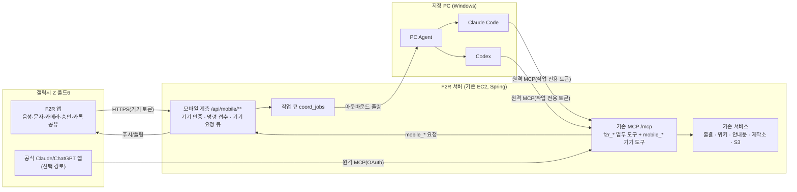

# F2R Mobile MCP 기술 설계서 (Android 앱 ↔ PC MCP 연동 구조 포함)

- 상태: **설계안(미구현)**. 운영 시스템은 바꾸지 않았다. 개발은 보고·승인 후에 진행한다.
- 작성일: 2026-11-19
- 관련 문서: [Coordinator 설계](../F2R_Coordinator_Architecture.md), [구독 검증](../F2R_Subscription_Verification.md), [조사](../F2R_COORD_Audit.md)

## 1. 사전 조사 결과 (지시서 9항 "먼저 조사")

| 조사 항목 | 결과 | 근거 |
|---|---|---|
| 기존 MCP 원격 접속 | **지원한다.** 운영 `https://feel2real.co.kr/mcp`, Streamable HTTP(JSON-RPC)로 PC 밖에서도 HTTPS로 접속된다 | 코드 `McpController`, 운영 OAuth 메타데이터 조회 |
| 인증 방식 | OAuth 2.1 + PKCE(S256), 동적 클라이언트 등록, 접근 토큰 15분, 갱신 토큰 30일, scope별 별도 동의 | `McpOAuth`, `docs/studio-collaboration/CHATGPT_STUDIO_CONNECTION.md` |
| 허용된 접속처 | callback 허용 목록에 `claude.ai`와 `chatgpt.com` 두 곳만 있다. **PC의 Claude Code CLI(localhost)는 아직 허용하지 않는다** | `McpOAuth.java` |
| 실제 사용 | 이 계정의 Claude 커넥터로 11/18~11/19에 약 100건 호출 | 운영 감사 로그(`activity_history`) |
| Android에서 쓰기 | **공식 Claude 앱은 원격 커넥터를 모바일에서 지원한다**(Free~Enterprise). ChatGPT 앱은 플랜에 따라 쓰기가 제한될 수 있다(확인 필요) | Claude connectors 문서 / OpenAI 도움말 요약 |
| 휴대폰에서 MCP 서버 상시 실행 | **필요 없다.** MCP 서버는 F2R 서버에 그대로 둔다 | 지시서 9항 |

**왜 "PC에서는 되는데 휴대폰에서는 안 되는가"**
- MCP 서버 자체는 휴대폰에서도 접속할 수 있다.
- 막히는 부분은 두 가지다.
  1. AI가 **휴대폰의 카메라·스피커·승인 화면·카카오톡 공유**를 쓸 방법이 없다.
  2. AI 실행이 PC(Claude Code·Codex) 또는 공식 앱 안에서만 일어난다.

## 2. 결정: 별도 Gateway 서버를 만들지 않는다

- **AI 쪽 연결**: 기존 원격 MCP로 충분하다. MCP 서버는 교체하지 않고, 도구만 추가한다(`f2r_*`, `mobile_*`).
- **휴대폰 쪽 연결**: F2R Android 앱은 AI가 아니어서 MCP 클라이언트가 될 필요가 없다. 그래서 **기존 Spring 서버 안에 "모바일 계층"을 추가한다.** 지시서의 "F2R Mobile MCP Gateway"는 별도 서버가 아니라 **기존 서버 안의 모듈**로 만든다.
  - `/api/mobile/**`: 기기 인증, 명령 접수, 작업 상태, 기기 요청 처리
  - 기기 요청 큐(`mobile_device_requests`)
  - 푸시 알림(선택)
- **장점**: 인증·감사·권한 검사를 한 곳에서 한다. 운영 서버가 하나라 배포와 보안 관리가 단순하다.

## 3. 연동 구조도

**글로 적은 흐름(예: 학습지 HTML)**
1. 앱에서 "클로드, 이 학습지 HTML로 만들어"라고 말한다.
2. 받아 적은 글이 `POST /api/mobile/commands`로 들어가 `coord_jobs`에 등록된다(실행 대상 CLAUDE).
3. PC Agent가 작업을 가져가 Claude Code를 실행한다.
4. Claude Code가 `mobile_camera_capture`를 호출하면, 서버가 휴대폰에 "촬영 요청"을 보낸다.
5. 사용자가 앱에서 촬영 → `mobile_image_upload`로 사진이 서버로 올라가고, 사진 ID가 Claude Code에 전달된다.
6. Claude Code가 HTML을 만든다 → `f2r_document_to_html`(초안 저장) → `mobile_request_approval` 호출
7. 앱에서 원본과 HTML을 나란히 보고 승인 → 게시. `mobile_speak`로 "게시했습니다"라고 읽어 준다.

- 촬영을 먼저 하고 명령하는 순서도 된다. 앱에서 먼저 찍어 올리면 작업에 사진 ID가 함께 들어간다. 이쪽이 더 단순하고 기본으로 권장한다.

## 4. AI 실행 경로와 비용 부담 (지시서 6항)

**MCP는 AI 모델의 실행 비용을 부담하지 않는다.** MCP는 AI가 F2R 업무 도구를 쓰는 통로일 뿐이다. 모델 실행 비용은 아래 경로 중 하나가 부담한다.

| 경로 | AI 실행 위치 | 비용 부담 | 공식 지원·정책 | 용도 |
|---|---|---|---|---|
| E1. F2R 앱 → 서버 → **PC Agent → Claude Code·Codex** | 지정 PC | 각 PC에 로그인한 **구독**(한도 안) 또는 **API 키**(토큰 과금) | 공식 CLI 비대화 실행. 구독으로 자동 실행하는 것은 정책 회색지대 → 본인 업무용 시험 단계는 서면 확인 후 구독, 서비스로 제공할 때는 **API 키** | HTML·교육 자료 파일 생성, 무거운 작업 |
| E2. F2R 앱 → 서버 → **모델 API** | Anthropic/OpenAI 서버 | F2R의 **API 키**(토큰 과금) | 공식 권장 | PC가 꺼져 있을 때의 가벼운 작업(문항 생성·검증, 안내문). 지금은 데모 단계 스위치 `anthropic.enabled=false`로 꺼져 있다 → 켜려면 별도 승인 |
| E3. **공식 Claude/ChatGPT 앱** + F2R 커넥터 | 각 회사 서버 | 사용자 **구독**(한도 안) | 정상 사용(공식 앱 기능) | 구독만으로 쓰는 경로. F2R 앱에서 "Claude 앱으로 열기"로 넘긴다(공유 인텐트) |
| E4. 공식 원격 기능(Remote Control·Dispatch·Codex Remote connections) | 지정 PC | 구독 | 공식 기능. 사람이 휴대폰에서 직접 조작한다 | 사람이 지켜보며 하는 PC 작업 |

- **F2R 앱이 유료 구독 계정을 자동으로 직접 제어한다고 가정하지 않는다.**
  - F2R 앱은 Claude·ChatGPT에 로그인하지 않는다. 구독 토큰도 받지 않는다.
  - 구독을 쓰는 방식은 두 가지뿐이다: 공식 앱(E3·E4), 또는 사용자 PC에서 사용자가 직접 로그인한 공식 CLI(E1).
- "클로드/지피티" 선택은 이렇게 된다.
  - E1: CLAUDE → Claude Code, GPT → Codex
  - E2: 각 회사 API
  - E3: 해당 공식 앱으로 넘긴다

## 5. 구성 요소별 책임

### A. F2R Android 앱
- **자동 로그인**: 처음 한 번 아이디·비밀번호로 로그인하고 기기를 등록한다. 이후에는 Keystore에 둔 기기 토큰으로 짧은 접근 토큰을 받는다.
- **명령**
  - 한국어 음성(`SpeechRecognizer`), 문자 입력
  - AI 작업 선택: 클로드 / GPT / 자동
  - 실행 경로 선택: PC / 서버 / 공식 앱
- **카메라**: CameraX. 문서 테두리·초점·흔들림 점검, 미리보기, 다시 찍기, 업로드.
- **작업 화면**: 상태, 결과, 승인·거절·수정, 카카오톡 공유.
- **기기 요청 처리**: 서버에서 온 `mobile_*` 요청(촬영·음성 질문·읽어 주기·승인·공유)을 화면에 띄우고 사용자 동작으로만 처리한다. 운영체제 권한과 사용자 확인을 우회하지 않는다.
- **알림**: 앱이 열려 있을 때는 3초마다 조회한다. 닫혀 있을 때는 FCM 푸시를 쓴다(선택, 2단계).

### B. Mobile MCP 계층 (기존 서버 안)
- 기기 인증·권한: 기기 토큰(해시 저장), 짧은 접근 토큰, 역할·사업체 권한 검사
- 기존 MCP 도구 연결: `f2r_*` 도구가 기존 서비스를 부른다. 같은 서비스 함수를 REST(앱)와 MCP(AI) 양쪽에서 쓴다.
- 작업 요청 전달·상태 관리: `coord_jobs`(Coordinator 설계 §3 상태 머신)
- 승인 필요 작업 구분: 정책표(Coordinator 설계 §8)
- PC Agent 작업 전달: 아웃바운드 폴링
- 결과·오류 반환: 앱 조회 API, 기기 요청 응답, 감사 로그

### C. PC Agent
- [F2R_PC_Agent.md](../F2R_PC_Agent.md) 그대로: 연결 확인, Claude Code·Codex 실행, 파일 생성·업로드, 끊김 시 대기·복구

## 6. 데이터 (신규, 구현 시 V1123부터)

- Coordinator 설계 §4의 표를 그대로 쓴다: `coord_devices`, `coord_jobs`, `coord_job_events`, `coord_job_files`, `easy_student_links`
- 이번에 하나를 추가한다.

| 테이블 | 핵심 컬럼 | 설명 |
|---|---|---|
| `mobile_device_requests` | id, job_id, device_id, kind(`CAMERA`/`VOICE_INPUT`/`SPEAK`/`APPROVAL`/`KAKAO_SHARE`/`SHOW_STATUS`), payload JSON, status(`PENDING`/`DONE`/`DECLINED`/`EXPIRED`), result JSON, expires_at(기본 5분), created_at, answered_at | AI가 요청하고 사람이 휴대폰에서 응답한다. 시간이 지나면 `EXPIRED`가 되고 AI에게 "사용자 응답 없음"을 돌려준다 |

## 7. PC·모바일 공통 업무 도구

- 공통 도구는 [F2R_Mobile_MCP_Tools.md](F2R_Mobile_MCP_Tools.md) §3에 정리했다. 이미 있는 도구를 먼저 쓴다.
- 인증은 환경마다 다르다.
  - PC AI: OAuth 또는 작업 전용 토큰
  - 공식 앱: OAuth
  - F2R 앱: 기기 토큰
- 그래도 **같은 서비스 함수와 같은 권한 검사**를 지난다.

## 8. 변경 예정 파일 (아직 만들지 않음)

| 구분 | 파일 |
|---|---|
| DB | `V1123__coordinator_devices_jobs.sql`, `V1124__easy_student_links.sql`, `V1125__mobile_device_requests.sql` + Entity + `docs/DOMAIN.md` |
| 서버 | `domain/mobile/**`(Controller·Service: 기기 인증, 명령, 기기 요청), `domain/coordinator/**`, `config/security/MobileDeviceTokenFilter.java`, `CoordAgentTokenFilter.java`, `SecurityConfig.java`(필터·경로 허용 목록), `domain/mcp/McpGateway.java`(`f2r_*`, `mobile_*` 도구 + scope `coord:read`, `coord:draft`, `mobile:request`), `McpOAuth.java`(CLI localhost callback — **보안 검토 후 별도 PR**), `EasyAttendanceService`(이름 검색·중복 확인 **추가만**) |
| 설정 | `app.coordinator.enabled`(기본 false), `app.mcp.allowed-scopes`에 새 scope 추가(운영 반영은 승인 후 `/etc/f2r/env`) |
| 앱 | 별도 저장소 `f2r-coordinator-android`(Kotlin·CameraX·Compose) |
| PC | `coord-agent/`(Node.js) |
| 문서 | `docs/API.md`, `docs/FLOWS.md`, `docs/DOMAIN.md`, `docs/INDEX.md` |
