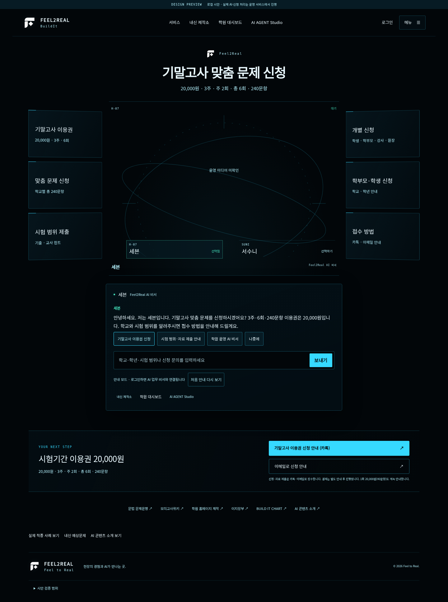
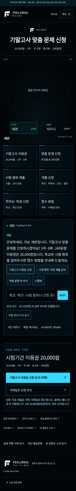

# Feel2Real 홀로그램 시안 기능 복원과 검증

> 후속 Hyper3D 조사·무료 로컬 GLB 검증: [보고서와 캡처](evidence/hyper3d/report.html), [실행 방법](hyper3d/README.md). 실제 승인 캐릭터 모델은 미확보이며 기존 기능을 유지하는 별도 검증 모드입니다.

기준 main: `df425588c97d7f1fb668e23452e638bc9cb14fd4` (2026-10-27 원격 재확인).

기존 블랙·청백색 디자인, 화이트 로고, 원형 HUD, PC 원근 메뉴와 모바일 배치를 유지하며 **중앙 영상·인사·6개 신청 안내·미인식 선택지·처음 안내 다시 보기**를 복원했습니다. 이 디렉터리는 독립 검토용 시안이며 제품 리소스, 운영 main, DB, 배포 설정을 변경하지 않습니다.

## 구현과 원본 보존

- `vendor/f2r_home_agent.js`와 `vendor/f2r_agent_clip_switch.js`는 기준 main과 **바이트 단위로 동일**합니다. 안내 규칙 일부를 다시 구현하던 이전 시안 대신 실제 DOM 이벤트·welcome·mainChoices·로그인 handoff·manifest 로딩·영상 전환 전체를 재사용합니다. `provenance.json`에 해시를 기록했습니다.
- 공개 `/api/agent-media/public` 및 `/agent-media/public/{seven|suni}/{file}`, ADMIN·TUTOR `/api/dashboard/agent-media` 및 `/dashboard/agent-media/{agent}/{file}` 분기를 그대로 사용합니다. 선택 사진은 main의 `front.webp → poster.jpg` 우선순위입니다.
- 중앙 `homeVideo`/`homeVideoAlt`에서 대기 `idle.mp4`, 생각 `think.mp4`, 사용자 선택 후 고정 인사 `speak.mp4`를 사용합니다. 인사 종료 후 대기로 돌아가며 일반 안내를 임의 립싱크로 표시하지 않습니다.
- `presentation.js`는 메뉴 열기/닫기·표시 이름·포스터 대체를 연결합니다. 인사·응답·의도 판정은 작성하지 않습니다. 실패 시 main이 현재 캐릭터에 지정한 poster URL을 사용하고 이전 캐릭터의 포스터는 남기지 않습니다. 포스터도 없으면 미확인 상태를 표시합니다.
- 얼굴·의상 이미지/영상은 생성·편집하거나 포함하지 않았습니다. 표시에는 `object-fit:contain`, 이미지 `opacity:1`, `filter:none`을 사용합니다. 로고는 기존 검토본의 흰색 SVG를 그대로 사용합니다.
- 6개 타일의 제목·보조 문구·`exam` 동작은 main에서 그대로 가져왔습니다. 미인식 질문에는 main의 세 선택지, 처음 안내에는 네 선택지가 표시됩니다. ‘나중에’ 저장과 ‘처음 안내 다시 보기’도 main 동작입니다.
- 삭제된 Human Intelligence 문구는 제거했습니다. 가격은 main에 있는 20,000원, 3주·6회·240문항 및 1회 20,000원(40문항) 안내를 사용합니다.

## 실행

```sh
cd docs/prototypes/hologram-home
python serve.py
# http://127.0.0.1:8765/
```

기본 서버는 미디어 없는 공개 manifest를 제공합니다. 운영 서버를 프록시하거나 DB에 연결하지 않습니다. **이미 승인 원본임이 확인된 로컬 폴더**가 있다면 `python serve.py --media-dir /absolute/approved-media`로 읽기 전용 제공할 수 있습니다. 폴더는 `seven/`, `suni/` 아래 원래 파일명을 사용합니다. 이 옵션이 원본 승인·동일성을 대신 검증하지는 않습니다.

제품 서비스 목적지·로그인·권한은 이 정적 서버에서 구현하지 않습니다. 실제 같은 출처 앱에 통합하기 전에는 서비스 href와 handoff 계약만 검증할 수 있습니다. 원본 미디어를 임의 다운로드하거나 과거 시트로 대체하지 마세요.

## 재현 가능한 검사

서버를 별도 터미널에서 실행한 뒤:

```sh
npm ci
# Chromium이 없으면 먼저 로컬 설치. 기본 경로는 /usr/bin/chromium.
CHROMIUM_PATH=/usr/bin/chromium npm run test:legacy
CHROMIUM_PATH=/usr/bin/chromium npm run test:restoration
```

외부 네트워크 요청은 검사에서 차단됩니다. `PLAYWRIGHT_MODULE`로 설치된 Playwright 모듈 경로를 지정할 수도 있습니다. `EVIDENCE_DIR`로 결과 위치를 바꾸면 제출된 증거를 보존할 수 있습니다. 기존 75개 검사는 동일한 15개 검증 목적을 유지하면서 main DOM ID, 상대 URL, 비동기 응답 대기와 실행 경로만 이식했습니다. `tests/legacy-75.cjs`에 변경 범위를 표시했습니다.

main의 기존 20개 검사는 저장소 루트에서 각각 실행합니다:

```sh
node src/test/js/f2r_home_agent.test.js
node src/test/js/home_agent_exam_contract.test.js
node src/test/js/home_hologram_intake.test.js
```

## 실제 실행 결과

| 검사 | 결과 | 근거 |
|---|---|---|
| 기존 시안 검사 | PASS 75 / FAIL 0 | [verification.json](evidence/verification.json) |
| 기존 main 안내·신청 | PASS 20 / FAIL 0 (14+2+4) | [main-20.json](evidence/main-20.json), 개별 로그 |
| 추가 기능·원본 코드 검사 | PASS 118 / FAIL 0 | [restoration.json](evidence/restoration.json) |
| 운영 캐릭터 원본 일치·운영 MP4/음성 | 미검증 | 운영 브라우저·실제 미디어 미확보 |
| 실서비스 로그인·내신 제작소·대시보드·Studio 목적지 | 미검증 | 링크와 요청 전달 계약만 로컬 확인 |
| DB 변경 통합 E2E | 미실행 | 사용자 금지 범위. 테스트 DB도 생성·수정하지 않음 |

추가 118개는 너비별 22개×5, 소스 일치 검사 5개, 경계 시나리오 3개입니다. 따라서 로컬 검사 합계는 213 PASS이며 운영 성공 수치가 아닙니다. 신규 Java·제품 코드 변경이 없어 전체 Gradle 빌드·제품 서버 부팅은 실행하지 않았습니다.

| 화면 | 기존 검사 | 복원 동작 검사 | 가로 넘침 / JS 오류 | 운영 미디어 |
|---|---|---|---|---|
| 360×800 | PASS 15 | PASS 22 | 0 / 0 | 미검증 |
| 390×844 | PASS 15 | PASS 22 | 0 / 0 | 미검증 |
| 430×932 | PASS 15 | PASS 22 | 0 / 0 | 미검증 |
| 768×1024 | PASS 15 | PASS 22 | 0 / 0 | 미검증 |
| 1440×1050 | PASS 15 | PASS 22 | 0 / 0 | 미검증 |

Playwright 1.64.1, Chromium, DPR 1, 너비별 새 컨텍스트를 사용했습니다. 모바일은 touch/isMobile 에뮬레이션이며 창 크기 조절 방식은 사용하지 않았습니다. 실제 휴대폰·키보드·운영 음성·성능 지표는 미검증입니다.

## 기능별 동작 증거

| 기능 | 관찰한 동작 | 판정 |
|---|---|---|
| 중앙 영상 | fixture MP4의 실제 currentTime 증가와 재생 상태 확인 | PASS 로컬 |
| 캐릭터 인사 | 세븐·서수니 선택 후 각 고정 대사와 speak.mp4, muted=false/loop=false; 종료 후 idle.mp4 | PASS 로컬, 실제 음성 미검증 |
| 실패 대체 | MP4 404 후 현재 캐릭터 poster.jpg 표시. 서수니 선택 후 세븐 포스터가 남지 않음 | PASS 로컬 |
| 초기 안내 | main과 동일한 인사 및 선택지 4개 | PASS |
| 신청 안내 6개 | 제목/보조 문구 일치, 각각 exam 응답·가격·필수 자료·카카오·메일·적중 사례 링크 | PASS |
| 미인식 질문 | ‘오늘 날씨’ 후 선택지 3개, 신청 선택 시 실제 안내 응답 | PASS |
| 안내 다시 보기 | ‘나중에’ 후 새로고침 상태 유지, 다시 보기로 네 선택지 복원 | PASS |
| 로그인 분기 | 비로그인 returnUrl 보존; 모의 ADMIN은 private media 경로 및 pendingAsk 저장 후 /dashboard 이동 | PASS 모의 권한, 실제 인증 미검증 |
| 로고·문구·디자인 | 로고 3곳 로드, 원형 SVG 링·PC 원근 카드·모바일 2열, 삭제 문구 없음 | PASS |

## 캡처

총 40장: 기존 검사 캡처 20장과 복원 동작 20장. `*-seven-home`, `*-seven-viewport`, `*-suni-home`, `*-menu`는 외부 미디어 차단 상태의 레이아웃입니다. `*-six-intake-actions`, `*-unknown-choices`, `*-suni-fixture-video`, `*-failed-video-poster`는 ‘TEST FIXTURE’ 글자가 있는 단색 테스트 영상·포스터를 사용합니다. **테스트 패턴은 운영 캐릭터가 아니며 얼굴·의상 승인 근거로 사용할 수 없습니다.**

### PC 시안



### 모바일 시안



[390px](evidence/captures/390-seven-home.png) · [430px](evidence/captures/430-seven-home.png) · [768px](evidence/captures/768-seven-home.png) · [PC 메뉴](evidence/captures/1440-menu.png) · [모바일 메뉴](evidence/captures/390-menu.png)

### 인사 영상과 오류 대체

[서수니 테스트 영상](evidence/captures/1440-suni-fixture-video.png) · [360px 영상 실패 후 포스터](evidence/captures/360-failed-video-poster.png) · [6개 신청 실행 결과](evidence/captures/390-six-intake-actions.png) · [미인식 질문 선택지](evidence/captures/390-unknown-choices.png)

## 운영 확인에 남은 항목

운영 브라우저에서 두 선택 사진의 src/currentSrc, 영상 src/currentSrc/poster/readyState/videoWidth/currentTime 증가, Network 응답 상태·Content-Type·크기·캐시, 원본 SHA-256과 얼굴·의상 일치를 확인해야 합니다. 현재 환경의 네트워크 허용 목록에는 운영 도메인이 없으므로 실패 접속을 반복하지 않았습니다. 운영 미디어·DB·유료 생성·배포는 수행하지 않았습니다.
