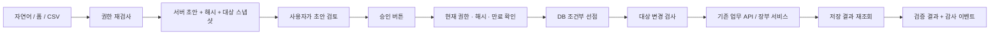

# 작업 A — 통합 대시보드와 AI 업무 비서

상태: 로컬 프로토타입. 운영 배포·운영 DB 변경·main 병합 없음. 금융기관 접속·수집기·작업 B 변경 없음.

- 분석 기준: GitHub `main` / PR #851 / `e7247e831c3b82a67e880621d041759067125360` (2026-10-22). fetch 후 GitHub API·최근 병합 SHA·Build Check 성공과 교차 확인했다.
- 최종 main 동기화: `07d9316a293a30a84e13a09c42957bd64be71bd8` / PR #852. 변경은 읽기 전용 운영 진단 셸 22행이며 feature 브랜치에 병합했다.
- 작업 브랜치: `feat/unified-ai-assistant`.
- AcademyCraft 참조/실행 코드: `woori73/academycraft` / `115477f7ea0afa27dd69d9ae12318261c47a5a82`. 해당 저장소 코드는 변경하지 않았다.
- 실행 화면: 로그인 후 `/dashboard`. 공통 로그인 계정 메뉴에서는 미완료 사용자에게 환영 안내 링크가 나오고, 기존 ADMIN·TUTOR 화면에도 진입 링크가 있다. 로그인한 원래 화면은 유지한다.
- 검증 증거: [테스트 결과](verification.md), [화면 캡처](screenshots/).

## 1. 기존 구조 분석

| 영역 | 확인한 코드 | 현재 구조와 재사용 지점 |
|---|---|---|
| 로그인·권한 | `config/SecurityConfig.java`, `config/security/JwtAuthenticationFilter.java`, `domain/user/` | HTTP-only JWT 쿠키. UI의 캐시·사용자 입력은 권한 근거가 아니다. 새 API도 필터의 ADMIN/TUTOR 제한 + 서비스의 현재 DB 역할 재검사를 사용한다. 기존 프로젝트에서 메서드 보안 활성화가 확인되지 않아 `@PreAuthorize`에 의존하지 않았다. |
| ADMIN | `templates/admin/dashboard.html`, `fragments/_admin_topnav.html`, `/admin/hub` | 자료 업로드·Wiki 운영·관리 서비스 허브가 남아 있다. 이를 없애지 않고 공용 대시보드의 AI 비서로 연결한다. |
| TUTOR | `templates/tutor/tutor_dashboard.html`, `tutor/academy_builder.html` | 기존 학생 목록과 홈페이지 편집 흐름. 각 화면에 통합 비서 링크를 추가한다. |
| 공용 대시보드 | `templates/dashboard.html`, `domain/easy/controller/DashboardWidgetController.java` | `/api/dashboard/businesses`, `/api/dashboard/widgets`로 허용된 재무 지표를 표시한다. 중복 `aiFab` ID와 별도 읽기 전용 패널이 있었다. 단일 AI 진입 버튼과 학원·장부 공통 대화창으로 정리했다. |
| AcademyCraft | `domain/academycraft/AcademyCraftGateway.java` | localhost:8082로만 연결하는 서명 게이트웨이. 현재 BuildIt 사용자·역할·소유 학원을 다시 읽고 HMAC으로 본문·경로·신원을 묶는다. AcademyCraft가 binding·회원 역할·학원 활성·대상 소속을 매 요청 검증한다. 브라우저에 별도 인증키를 주거나 신규 회원/권한을 자동 생성하지 않는다. |
| 기존 AcademyCraft AI | 게이트웨이의 정확 `/agent` 5경로, AcademyCraft `docs/agent-approval.md` | 기존 서버 계획/해시/10분 만료/원장 승인 프로토콜. 등록·배정 등 일부 도구만 쓰기를 제공한다. 반 생성·출결·상담 전체를 다루지는 않는다. 기존 AI 경로·프로토콜·권한을 변경하지 않았다. |
| 이지장부 | `EasyTutorAccessService`, `EasyTutorImportService`, `EasyImportService`, `EasyWorkspaceService` | ADMIN은 활성 사업체, TUTOR는 활성 소유 학원과 서버 링크로 허용된 사업체만 접근한다. CSV 원본 행 보존·기존 이지샵 계정 매핑·분류·중복 방지·미분류 거래 저장을 재사용한다. |
| 기존 장부 AI | `EasyAgentService`, `EasyAgentLlmInterpreter`, `DashboardAssistantService` | 장부 대화·계정 변경·import 승인과 Muse Spark 재무 해설이 있다. 해설 API를 그대로 연결하며, 새 통합 승인 엔진은 자연어 문자열을 승인으로 해석하지 않는다. |
| 도움말 AI | `domain/academycrafthelp/`, `resources/help/academycraft/` | 검수된 도움말만 근거로 설명하는 읽기 전용 비서. 기존 도움말 링크를 재사용하며 새 실행 권한을 부여하지 않는다. |

새 통합 비서는 기존 도메인 테이블을 직접 수정하지 않는다. 신규 승인 상태·안내 진행·감사 이벤트만 자체 테이블에 저장하고, 실제 업무는 기존 업무 REST API 또는 장부 서비스에 위임한다. 기존 AcademyCraft `/agent` 계획은 별도 계약으로 유지한다. 새 계획에서 해당 계획을 대신 승인하거나 `writeApproved`를 보내는 경로는 없다.

## 2. 필수 범위 대응

| 요구 | 구현 |
|---|---|
| 첫 방문·환영 | 사용자별 서버 진행 행. 최초 접근 감지, 공통 로그인 후 환영 링크, 대시보드의 6단계 안내 |
| 역할별 기능 소개 | ADMIN/TUTOR 설명과 실제 AcademyCraft 원장/강사 연결을 구분. 강사 연결 계정은 조회 가능, AI 학원 쓰기 거부 |
| 메뉴 하이라이트·단계별 안내 | 학생/반·출결·상담·장부·승인 영역 강조, 이전/다음/나중에 계속/다시 시작 |
| 학생·반·출결·상담 | 학생 등록/수정, 반 생성/수정/학생 배정, 출결 기록, 상담 작성/후속 메시지. 정정·월별 출결 등은 기존 화면 링크 |
| 거래·증빙 | 직접 거래 입력과 CSV 초안. 증빙 유형과 원본 행 보존. 기존 계정 분류 변경 승인. 이미지/PDF OCR은 제공하지 않음 |
| 자연어·파일 | 하나의 대화에서 자연어 → 승인 전 초안. 학생 명단/거래 CSV·업무 지시 TXT ≤256KB. 학원 자료 최대 20행, 보완할 행 별도 보고. Muse Spark 미연결 시 표시된 규칙 분석 사용 |
| 초안·승인·API | 서버 저장 초안 + 내용 해시 + 명시적 승인 버튼 + 기존 API 실행. 사용자의 자연어 “승인”은 실행을 일으키지 않음 |
| 검증·감사 | 학생·반·상담·출결 재조회. 장부 거래 ID/날짜/금액/수입·지출 재조회. 사용자별 생성/승인/결과 이벤트 |
| 진행 저장·재개 | DB 진행 단계·완료·역할·낙관적 버전. 브라우저/탭 변경 뒤 재개, 오래된 버전은 409 |
| 운영·재무 통합 조회 | 선택한 허용 학원의 학생·반·오늘 출결 + 선택한 허용 사업체의 수입·지출·미수금. 학원/사업체 이름·집계일·기준월을 따로 표시 |

업무 처리는 등록·수정을 지원한다. 삭제·비활성화는 기존 정책과 화면을 사용한다. 상담 원문 수정은 기존 API에도 없어 후속 메시지로 기록을 이어간다.

## 3. 승인과 검증 흐름

- `PENDING → EXECUTING → VERIFIED / REVIEW_REQUIRED / FAILED / UNKNOWN`.
- 취소 `CANCELLED`, 만료 `EXPIRED`, 대상 변경 `INVALIDATED`. 종료 상태에서 자동 재실행하지 않는다.
- 승인 선점은 행 잠금에 더해 `UPDATE ... WHERE status='PENDING' AND expires_at>now`가 1행일 때만 성공한다. HTTP 요청의 기존 JPA 관리 객체가 오래된 PENDING일 수 있으므로, 관리 객체의 값만으로 실행을 결정하지 않는다.
- 승인 선점은 원격 호출 전에 커밋한다. 네트워크 단절/프로세스 중단으로 결과가 불확실하면 `UNKNOWN` 또는 `EXECUTING`을 유지하고 수동 확인하도록 한다. 성공 상태 재승인은 저장된 결과만 반환한다.
- 실행 입력은 서버 초안에서만 읽는다. 승인 본문은 `planHash`만 받으며 대상·금액·내용을 다시 받지 않는다.
- 대상 변경은 승인 직전 스냅샷과 비교한다. 기존 API 자체에 버전 조건부 쓰기가 없으므로, **재조회와 원격 쓰기 사이에 수동 변경이 들어오는 경쟁까지 원자적으로 막지는 못한다.** 이를 위해 기존 API에 버전 계약을 추가하는 것은 별도 작업이다.
- 거래 업로드는 기존 import 초안에 원본 행을 보관한다. 실제 중앙 장부 반영은 사용자 승인 시 기존 `confirm`에서 수행한다. 승인한 미분류 실거래도 기존 정책대로 저장하고 REVIEW로 남긴다. 검토 수에는 저장된 미분류/증빙 미확인 거래가 포함되므로 저장 수와 겹칠 수 있다.
- 결과에는 수집·저장·중복·미분류·분류 완료·검토·실패 수를 표시한다. 장부 저장 0을 신규 거래 저장 완료라고 표시하지 않는다.
- 인증키가 포함될 수 있는 학생 생성/상세 API 응답은 메모리에서 재조회 검증에만 쓰고, 새 계획·결과·감사에 인증키를 저장하지 않는다. 감사에는 입력 원문 대신 계획 ID와 상태만 저장한다.

## 4. 권한·데이터 격리

1. HTTP 필터가 ADMIN/TUTOR만 허용한다. 서비스는 사용자 DB의 현재 역할과 JWT 역할이 일치하는지 매 요청 검사한다.
2. 학원 선택 목록과 현재 원장 역할은 서명 게이트웨이의 integration context에서 얻는다. 학원 선택값 자체로 권한을 부여하지 않는다. 학원 쓰기는 현재 연결된 `ACADEMY_OWNER`만 가능하다.
3. 학생/반/상담 대상은 기존 AcademyCraft API가 같은 학원 소속인지 확인한다. 등록·출결 등도 승인 직전 실제 대상과 연결을 다시 읽는다.
4. 공용 위젯·사업체 목록은 기존 의도대로 HTTP 필터에서도 ADMIN/TUTOR만 허용한다. 사업체는 기존 `EasyTutorAccessService`로 조회·초안·승인·재승인·기록 조회 때마다 검사한다. 장부의 학원 연결과 AcademyCraft 회원 역할은 서로 다른 권한 모델이며 혼용하지 않는다.
5. 초안은 만든 사용자·생성 시 역할에 귀속된다. 타 사용자 승인·타 학원·미연결 사업체를 거부한다. 권한을 잃은 과거 기록은 초안 목록에서 제외한다.
6. 새 변경 API는 고정된 동일 출처만 허용하고, 응답은 `Cache-Control: no-store`다. 요청의 Host/전달 헤더로 승인 출처를 정하지 않는다.
7. `buildit.unified-assistant.write-enabled` 기본값은 false다. local 설정에서만 true다. 운영에서 활성화하려면 별도 승인 후 설정해야 한다. 기존 AcademyCraft AI 스위치와 별개인 새 통합 쓰기 스위치다.

## 5. 로컬 실행과 테스트

검증 구성은 `127.0.0.1:3308`의 **전용 Docker MySQL 8.4**, 별도 스키마 `f2r_unified_test`·`ac_unified_test`, BuildIt 8080·AcademyCraft 8082다. 운영 DB·AWS·금융기관과 연결하지 않았다. 로컬 전용 로그인·학원·사업체 연결만 사용했다.

새 스키마는 `V1094__unified_assistant.sql`로 추가했다. 기준 main의 마지막 파일 V1093 뒤에 배치했으며, 기존 마이그레이션은 변경하지 않았다. 운영 DB 접속 금지 지시에 따라 운영 history를 조회하지 않았다. 병합/운영 적용 승인 시점에 번호 충돌을 다시 확인해야 한다.

재현 절차와 실제 검증 결과는 [verification.md](verification.md)에 있다. 테스트의 SQL 변경은 고정된 `unified-ai-mysql` 로컬 컨테이너와 두 테스트 스키마만 대상으로 한다.

## 6. 프로토타입의 경계

- 자연어·TXT 의도 해석은 기존 Muse Spark 전송 계층을 재사용한다. `model-analysis-enabled` 기본 false, local만 true이며 모델이 연결되지 않거나 응답이 잘못되면 표시된 규칙 분석으로 처리한다. 모델 응답의 업무·필드·타입·명시 ID를 검사하며 실행 권한은 주지 않는다. 실제 모델 응답은 이 환경 자격증명 부재로 미검증이다. 모호하거나 누락된 값은 직접 입력에서 보완한다.
- 기존 Muse Spark 재무 해설은 그대로 연결했다. 이 환경에는 모델 자격증명이 없어 실제 모델 응답은 검증하지 않았다. 기본 업무·승인 흐름은 모델 호출 없이 검증했다.
- 증빙 지원은 거래에 포함된 증빙 구분·원본 행의 보존과 조회다. 영수증 사진/PDF 원본 저장·OCR 자동 추출, 엑셀과 다중 파일은 후속이다. 학생 CSV는 한 파일 20행까지 개별 승인 초안을 만들며 이름·학년·학교·학부모 이름/연락처 열을 지원한다.
- AI 출결 정정은 기존 출결 화면으로 연결한다. 상담 알림은 기존 서비스 정책에 따르며 로컬 검증에서는 외부 SMS/메일 발송을 비활성화했다.
- timeout 후 자동 복구/분산 트랜잭션 재조정, 기존 API의 버전 기반 변경 검사, 모바일 실기기 키보드 검증은 후속이다. 이번 화면 검증은 Chromium PC/모바일 뷰포트다.
- 기존 `/api/tutor/easy/agent`의 자연어 승인 동작은 변경하지 않았다. 새 통합 비서는 이를 승인 경로로 호출하지 않으며, 새 초안은 새 승인 버튼에서만 실행한다.

운영 배포·운영 DB 적용·main 병합은 이 PR의 실행 범위에 포함하지 않는다.

## 7. 공통 대화창 보강

AcademyCraft와 이지장부는 하나의 대화 로그·자료 첨부·초안 카드·승인 버튼을 사용한다. 완전한 지시는 초안을 즉시 만들며, 불완전한 지시는 보완할 폼을 연다. 학생 명단과 거래 자료를 같은 브라우저 대화에서 연속 첨부·승인하고 실제 양쪽 API의 저장 결과를 확인했다. 대화 입력 문장 자체는 저장하지 않으며, 새로고침 시 현재 권한으로 서버 초안/처리 결과 최신 30개를 복원한다. 안내 진행은 별도 DB에서 계속 재개한다.

- CSV 파싱은 기존 EasyCsvFileAdapter의 UTF-8/CP949·인용 필드 처리를 공유한다. 거래 분류·증빙·원본 보존은 기존 Easy importer를 그대로 사용한다.
- 학생 CSV의 빈 이름·열 불일치 등은 행별로 보고하고, 유효한 행만 승인 대기 초안으로 만든다. 중복 학생 여부 판단은 기존 학생 등록 정책에 따르므로 이름만 같은 학생을 자동 병합하지 않는다.
- TXT는 한 줄에 하나의 지시다. 명시 ID가 없거나 자연어 승인/삭제 지시인 행은 실행하지 않으며 확인 사항으로 보고한다. 혼합 자료는 모든 요청 범위의 권한을 초안 생성 전에 검사한다.
- 원격 저장 요청의 명확한 4xx 거절은 FAILED다. 원격 저장 후 GET 실패나 시간 초과는 UNKNOWN으로 보존한다. 혼합 거래 자료는 저장/실패/검토 수를 함께 표시한다.

## 8. 독립 검수 반영 (2026-10-22)

| 검수 지적 | 조치 |
|---|---|
| 출결 "조회"가 쓰기 초안으로 오분류 (P1) | 조회 의도를 쓰기보다 먼저 판정. 읽기 전용 `ATTENDANCE_QUERY`(기존 출결 GET 재조회, 학원 연결 검증, 최근 20건·id/구분/시각만) |
| 출결 "정정" 미지원·중복 기록 (P1) | **정정 API 조사**: `AcademyCraftGateway.allowedPath`는 `/api/rea/{id}/attendance/**`를 메서드 구분 없이 허용하지만, 정정 요청의 경로·본문·사유 필드 규격이 이 저장소의 코드·계약서에 없다. 도움말(`docs/academycraft-help/README.md`, `help/academycraft/05-attendance.md`)은 "사유 필수, 없으면 400"만 기술한다. 근거 없는 호출을 추측하지 않고 **차단 + 기존 출결 화면 안내**로 처리(새 이벤트 추가 오분류 제거). AcademyCraft 쪽 계약이 확인되면 `ATTENDANCE_CORRECT` 초안(스냅샷·해시·재조회)으로 확장 |
| 공지 초안 미지원 (P1) | 쓰기 없는 문안 제안 `NOTICE_DRAFT`. 기존 notices API는 호출하지 않음 |
| Muse 사용량 제한 없음 (P1) | `AssistantModelBudget`: 사용자별 분당 6/일 60/자료당 3회(설정). 초과 시 규칙 분석 폴백. 건수만 로그(사용자·원문 미기록). 인스턴스 단위 — 다중 인스턴스 운영 시 공유 저장소 기반으로 확장 필요 |
| Origin 하드코딩 (P2) | `buildit.unified-assistant.allowed-origins` 설정화 |
| 감사로그 범위 누락 (P2) | `operation`·`academy_id`·`business_id` 추가 |
| EXECUTING 잔류 (P2) | 만료 후 5분 경과 시 `UNKNOWN` 전환(`GET /drafts` 시점, lazy). 자동 재실행 없음 |
| 연락처의 외부 AI 전송 (P2) | 전화번호·이메일이 포함된 텍스트는 모델에 보내지 않고 규칙 파서만 사용. 모델이 `parentPhone`을 출력해도 폐기. 마스킹 후 복원보다 단순하고 안전해 이 방식을 택함 |
| 투어와 메뉴 이동 미연동 (P2) | 목적 선택(학생·반/출결/상담/장부) + 강조 메뉴 클릭 시 다음 단계 저장 후 이동 |
| 지원하지 않는 기능 약속 문구 (P2) | 출결 메뉴 설명·투어 문구에서 '비서가 정정·월별 조회'로 읽히는 표현 제거 |
| 승인 전 import 배치 저장 (P2) | **코드 변경 없음(의도)**. 거래 CSV·`LEDGER_ENTRY`는 초안 생성 시 기존 importer가 배치와 원본 행을 보관한다(거래/장부 반영은 승인 후). 만료·취소 초안의 고아 배치 정리 정책은 후속 항목 |

