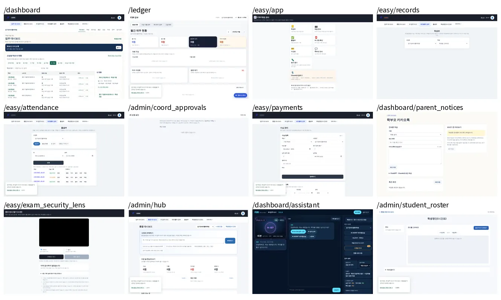
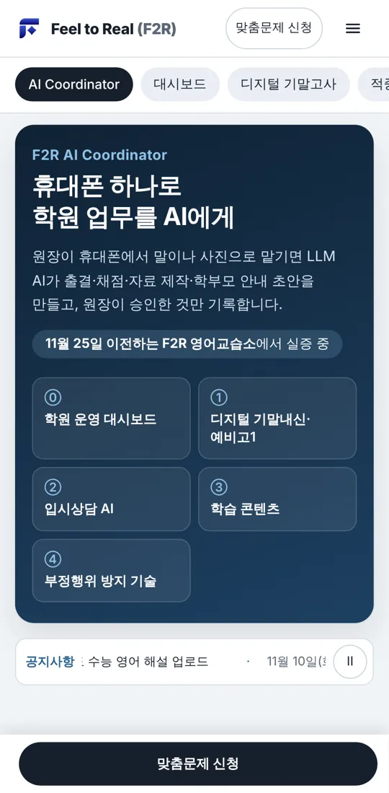
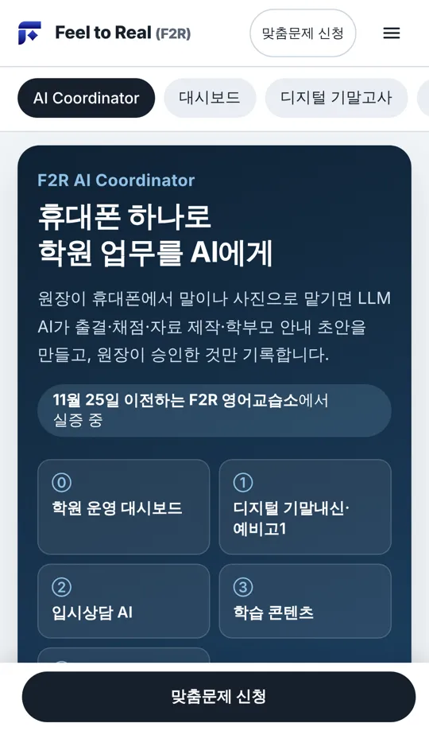
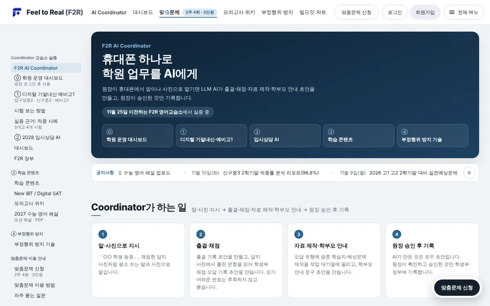

# 홈 첫 화면 개편 — AI Coordinator 중심 (2026-11-21)

지시: 「F2R 홈페이지 개편 지시서 — AI Coordinator 중심」(2026.11.21) 1~5번. 6번(재원생 디지털 모의고사 앱)은 데이터·권한 설계 확인이 먼저라 이번 작업에 넣지 않았다(아래 「남은 일」).
검증: 로컬 MySQL 8 + `bootRun`(local profile, dev-seed) + Playwright/Chromium. 캡처는 로컬 화면이다.

## 바뀐 순서

| # | 영역 | id | 비고 |
|---|---|---|---|
| 1 | F2R AI Coordinator(대표 문구) | `#coordinator` | 새로 만듦. "휴대폰 하나로 학원 업무를 AI에게", "11월 25일 이전하는 F2R 영어교습소에서 실증 중", 실증 기능 ⓪~④ 바로가기 |
| — | 공지사항 줄 | `#homeNotice` | 대표 문구 아래로 옮김(휴대폰 첫 화면에 대표 문구가 먼저 보이게) |
| 2 | Coordinator가 하는 일 | `#coordinator-work` | 새로 만듦. 카드 4개: 말·사진 지시 → 출결·채점 → 자료 제작·학부모 안내 → 원장 승인 후 기록 |
| 2-1 | ⓪ 학원 운영 대시보드 | `#academy-dashboard` | 새로 만듦. 가명 자료 예시 캡처 + "원장 로그인 후 사용" + `/dashboard`·`/ledger` |
| — | 주요 서비스 배너·홍보 영상·수능 해설·서비스 지도 | `#pass-offer` | 내용 그대로, 위치만 ⓪ 아래 |
| 3 | ① 디지털 기말내신·예비고1 | `#digital-exam`, `#pre-high-english`, `#dexam-guide` | "교습소 실증 ①" 표시만 더함 |
| 4 | 실증 근거: 적중 사례 | `#hit-proof` > `#hitCase`, `#exam-blog` | 맞춤문제 영역 안에서 이곳으로 옮김. "3개교 4개 시험" + 계산 기준 문장 |
| 5 | ② 2028 입시상담 AI | `#counsel` | "교습소 실증 ②" 표시만 더함 |
| 6 | ③ 학습 콘텐츠 | `#learning-content` | 새로 만듦. `/testprep`, `/wiki`, `/csat/2027-english` 카드 |
| 7 | ④ 부정행위 방지 기술 | `#exam-security` | 새로 만듦. 지시서 3번 문구 그대로, 렌즈 찾기 화면(사람 없음)·보안 무늬 견본 그림, "학교·학원 시연 문의" → `#exam-contact` |
| 8 | 맞춤문제·이용 안내 | `#service` > `#request`, `#svc-exam`, `#exam-payment`, `#exam-contact`, `#guide` | 제목만 "맞춤문제·이용 안내". 결제·문의 흐름 변경 없음 |
| 9 | 다른 서비스 | `#other-services` 머리말 + `#ai-content`, `#ebook`, `#review-game`, `#chart-showcase` | 지시서 순서(AI AGENT → 전자책 → 복습 게임 → 차트)로 바꿈 |

메뉴 묶음(전체 메뉴·사이드 메뉴·서비스 지도): ① Coordinator·대시보드·교습소 실증 ② 학습 콘텐츠 ③ 부정행위 방지 ④ 다른 서비스. 약관·환불 링크가 있는 「맞춤문제·이용 안내」는 따로 남겼다.
상단 링크 줄은 PC 폭을 넘지 않게 6개(AI Coordinator·대시보드·맞춤문제·모의고사 위키·부정행위 방지·빌드잇 차트)로 했다. AI AGENT·전자책은 전체 메뉴·사이드 메뉴·다른 서비스·배너에 그대로 있다.

## 지킨 것

- **삭제 없음**: 개편 전 `landing.html`의 id 전부 유지(새 id만 추가). 링크 주소도 전부 남음(상단 줄·바로가기 칩에서 일부 개수만 줄어듦).
- **사실만**: 적중률은 "3개교 4개 시험"과 계산 기준(압구정중3·언북중3은 대화문 5문항 제외, 압구정중2·신구중3은 시험 전체). 탐지율 등 성능 수치 없음. 'Claude' 대신 'LLM AI'. 재원생 수·학생 이름 없음(대시보드 캡처는 로컬 가명 자료 "가명 학생A~F", 재원생 수 배지는 가림).
- **얼굴 없음**: 새 그림 3장(대시보드 예시·렌즈 찾기 화면·보안 무늬 견본)에 사람이 없다. 학습 콘텐츠 카드에는 사람 얼굴이 있는 기존 위키 타일 그림을 쓰지 않았다.
- **가로 넘침 없음**: Pixel 7(412)·iPhone 14(390)·PC 1100/1200/1280/1366/1401/1424/1440/1920에서 `scrollWidth == clientWidth`. 개편 전 운영 홈에도 있던 1401~1421px 21px 넘침(로그인 버튼)은 상단 링크 줄 전환 기준을 1400→1424px로 올려 고쳤다.

## 운영자 대시보드 메뉴 전후 확인

관리자(dev-seed admin)로 로그인해 대시보드·원장 앱의 메뉴 25개를 개편 전후로 열었다. 전후 결과가 같다. 대시보드에서 보이는 링크 중 빠진 것 없음.
`/dashboard`, `/dashboard/*`, `/ledger`, `/easy/**` 템플릿과 코드는 이번 변경에서 건드리지 않았다.

| 메뉴 | 전 | 후 |
|---|---|---|
| /dashboard · /ledger · /easy/app | 200 | 200 |
| /easy/records(학생부) · /easy/attendance(출결부) · /easy/payments(수강료) | 200 | 200 |
| /admin/coord/approvals(승인함) · /dashboard/parent-notices(학부모 안내) | 200 | 200 |
| /admin/hub · /dashboard/assistant · /dashboard/info · /admin/student-roster · /admin/academy-move | 200 | 200 |
| /builder · /admissions/workspace · /easy/connections · /ai-agent-studio · /testprep · /easy/exam-security/lens | 200 | 200 |
| /academycraft/screens/*(4개) | 503 | 503 |
| /problem-generator · /admin/hub/exam-requests | 404 | 404 |

503·404 6개는 로컬에 별도 서버(academycraft·문제 생성기)나 운영 설정이 없어서 개편 전에도 같았다. 이번 변경과 관계없다.

## 새 첫 화면 캡처(사업계획서 붙임 사진 1 후보)

| 안드로이드(Pixel 7) | 아이폰(iPhone 14) |
|---|---|
|  |  |

## 테스트

- `LandingEdunovaTemplateContractTest` 등 홈 템플릿 계약 59건 통과. 순서·메뉴 단언을 새 순서로 고치고, 새 섹션 사실 문구 계약 1건 추가.
- CI JS 목록 332건 통과(`home_workspace` 메뉴 순서 단언 갱신, `home_motion` 실증 근거 모션 1건 추가).
- 원래 실패하던 테스트(이번 변경 전 main에서도 실패, CI 대상 아님): `TemplateBrandingTest` 2건(EDUNOVA 문구·dashboard/info favicon), `landing_promo_video.test.js` 1건.

## 남은 일

1. **6번 재원생 디지털 모의고사 앱**: 접속 코드 발급·재발급·폐기, 응시 기록 저장·삭제 정책, 원장 '새 응시 기록' 화면, 학생부 통합이 필요하다(DB 마이그레이션 + API). 시작 전 범위 확인 후 별도 PR. 홈의 "재원생 앱 설치" 버튼은 앱이 생기면 ① 영역에 넣는다(지금 넣으면 열리지 않는 버튼이 된다).
2. **적중 기준 문장**: 지시서의 "배우지 않은 외부 지문 제외" 기준은 저장소 자료에서 근거를 찾지 못해 넣지 않았다. 기존 블로그 기준(대화문 제외 / 시험 전체)만 적었다. 학교별로 외부 지문을 뺀 기준이 있으면 알려 주면 고친다.
3. **기존 적중률 % 표기**: 배너 아래·디지털 기말고사 아래·블로그 카드의 학교별 %는 기준 문장과 함께 이미 있던 내용이라 그대로 두었다.
